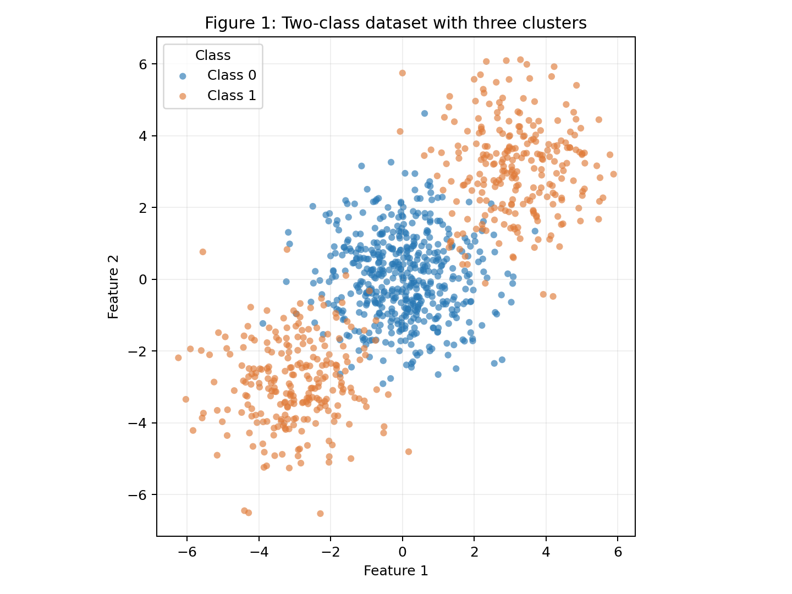
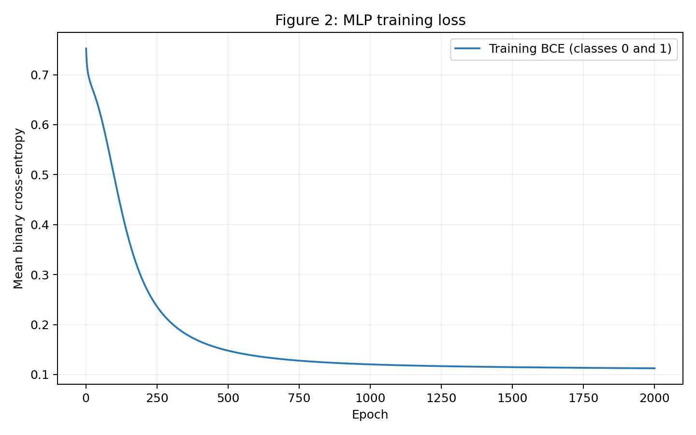
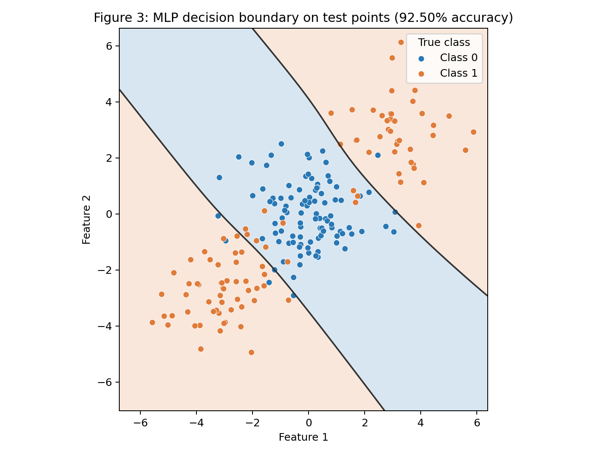
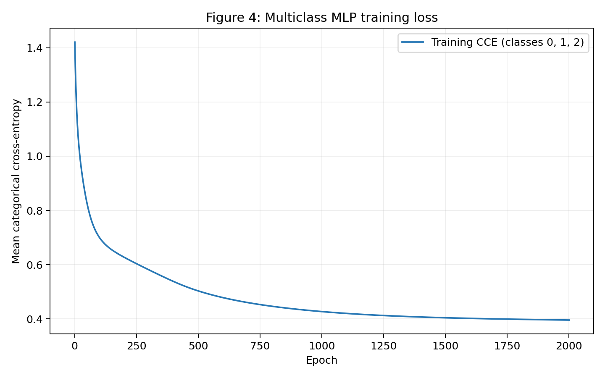
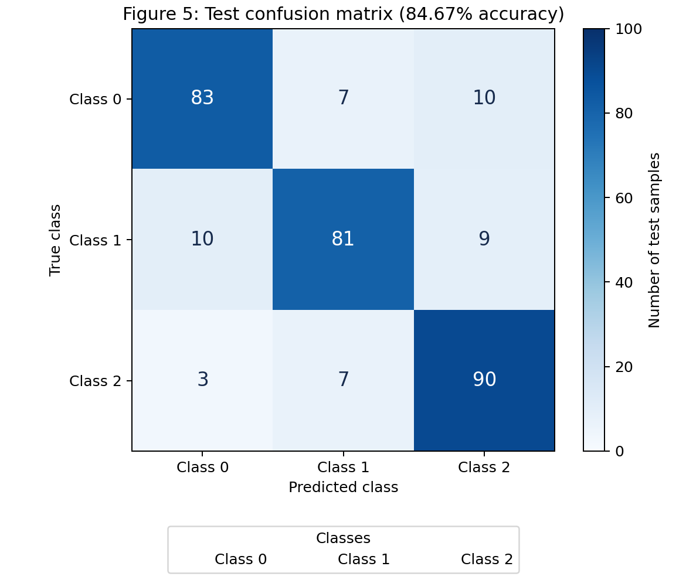
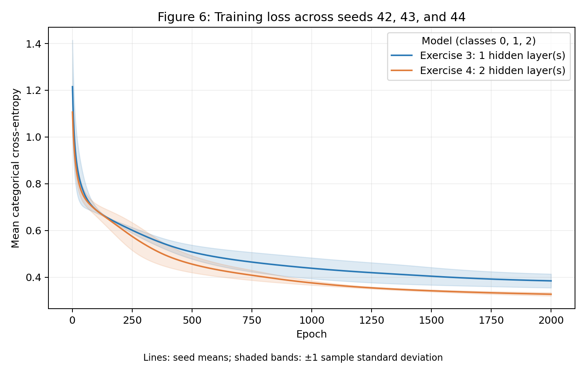

# 3. MLP

!!! abstract "Assignment"

    [Exercises → MLP](https://insper.github.io/ann-dl/2026.2/exercises/mlp/){:target='_blank'}

## Multi-Layer Perceptrons From Scratch

This activity builds a Multi-Layer Perceptron (MLP) using only NumPy, with the forward pass, the loss, the analytical gradients and the parameter updates all written by hand. It starts with one step of backpropagation worked out on paper (Exercise 1), then trains a network on a binary problem that no straight line can solve (Exercise 2), adapts the same network to three classes (Exercise 3), and finally asks whether a second hidden layer helps (Exercise 4).

!!! info "How the code is organized across exercises"

    The `MLP` class was developed in Exercise 2, where it supports arbitrary depth and layer sizes and a binary task - sigmoid output with binary cross-entropy. In Exercise 3 the same class is reused without changes: the multi-class task - softmax with categorical cross-entropy - was already supported by the class through the `task` argument, so only the layer sizes change (`[4, 8, 3]`). In Exercise 4 the class is reused again, now with two hidden layers (`[4, 8, 8, 3]`).

    The code that generates the data of Exercise 4 is the same as in Exercise 3: same `make_classification` call, same seed and same stratified split, so the two exercises are compared on exactly the same samples.

## Exercise 1 - One Step of Backpropagation, by Hand

The network has 2 inputs, one hidden layer with 2 `tanh` neurons, and one `tanh` output neuron, with mean squared error and $N = 1$. The given values are:

$$
\mathbf{x} = \begin{bmatrix} 0.5 \\ -0.2 \end{bmatrix},\quad y = 1.0,\quad
\mathbf{W}^{(1)} = \begin{bmatrix} 0.3 & -0.1 \\ 0.2 & 0.4 \end{bmatrix},\quad
\mathbf{b}^{(1)} = \begin{bmatrix} 0.1 \\ -0.2 \end{bmatrix},\quad
\mathbf{W}^{(2)} = \begin{bmatrix} 0.5 & -0.3 \end{bmatrix},\quad
b^{(2)} = 0.2,\quad \eta = 0.3
$$

Calculations keep full precision, and the displayed values are rounded to 6 decimal places.

### A - Forward Pass

**1. Hidden pre-activations**, $\mathbf{z}^{(1)} = \mathbf{W}^{(1)}\mathbf{x} + \mathbf{b}^{(1)}$:

$$
z_1^{(1)} = (0.3)(0.5) + (-0.1)(-0.2) + 0.1 = 0.15 + 0.02 + 0.1 = \boxed{0.270000}
$$

$$
z_2^{(1)} = (0.2)(0.5) + (0.4)(-0.2) - 0.2 = 0.10 - 0.08 - 0.2 = \boxed{-0.180000}
$$

**2. Hidden activations**, $\mathbf{h}^{(1)} = \tanh(\mathbf{z}^{(1)})$:

$$
h_1^{(1)} = \tanh(0.270000) \approx \boxed{0.263625}, \qquad
h_2^{(1)} = \tanh(-0.180000) \approx \boxed{-0.178081}
$$

**3. Output pre-activation**, $u^{(2)} = \mathbf{W}^{(2)}\mathbf{h}^{(1)} + b^{(2)}$:

$$
u^{(2)} = (0.5)(0.263625) + (-0.3)(-0.178081) + 0.2 \approx 0.131812 + 0.053424 + 0.2 \approx \boxed{0.385237}
$$

**4. Prediction and loss.** With the output activation $\hat{y} = \tanh(u^{(2)})$ and $L = (y - \hat{y})^2$:

$$
\hat{y} = \tanh(0.385237) \approx \boxed{0.367247}, \qquad
L = (1 - 0.367247)^2 = (0.632753)^2 \approx \boxed{0.400377}
$$

The network's prediction is **0.367247** and its loss is **0.400377**.

### B - Backward Pass

**1. Gradient at the output pre-activation.** Since $L = (y - \hat{y})^2$:

$$
\frac{\partial L}{\partial \hat{y}} = 2(\hat{y} - y) = 2(0.367247 - 1) = \boxed{-1.265507}
$$

The derivative of the output `tanh` is $\partial \hat{y} / \partial u^{(2)} = 1 - \hat{y}^2 \approx \boxed{0.865130}$, so

$$
\delta^{(2)} = \frac{\partial L}{\partial u^{(2)}} = \frac{\partial L}{\partial \hat{y}} \cdot \frac{\partial \hat{y}}{\partial u^{(2)}} \approx (-1.265507)(0.865130) = \boxed{-1.094828}
$$

**2. Output-layer gradients.** Since $u^{(2)} = W_1^{(2)} h_1^{(1)} + W_2^{(2)} h_2^{(1)} + b^{(2)}$, we have $\partial L/\partial W_j^{(2)} = \delta^{(2)} h_j^{(1)}$ and $\partial L/\partial b^{(2)} = \delta^{(2)}$:

$$
\frac{\partial L}{\partial W_1^{(2)}} \approx (-1.094828)(0.263625) = \boxed{-0.288624}, \qquad
\frac{\partial L}{\partial W_2^{(2)}} \approx (-1.094828)(-0.178081) = \boxed{0.194968}
$$

$$
\frac{\partial L}{\partial b^{(2)}} = \boxed{-1.094828}
$$

**3. Propagation to the hidden layer.** For each hidden neuron, $\partial L/\partial h_j^{(1)} = \delta^{(2)} W_j^{(2)}$:

$$
\frac{\partial L}{\partial h_1^{(1)}} \approx (-1.094828)(0.5) = \boxed{-0.547414}, \qquad
\frac{\partial L}{\partial h_2^{(1)}} \approx (-1.094828)(-0.3) = \boxed{0.328448}
$$

The hidden `tanh` derivatives are $1 - \tanh^2(0.27) \approx \boxed{0.930502}$ and $1 - \tanh^2(-0.18) \approx \boxed{0.968287}$, so

$$
\delta_1^{(1)} = \frac{\partial L}{\partial z_1^{(1)}} \approx (-0.547414)(0.930502) = \boxed{-0.509370}, \qquad
\delta_2^{(1)} = \frac{\partial L}{\partial z_2^{(1)}} \approx (0.328448)(0.968287) = \boxed{0.318032}
$$

**4. Hidden-layer gradients.** Since $z_i^{(1)} = \sum_j W_{ij}^{(1)} x_j + b_i^{(1)}$, we have $\partial L/\partial W_{ij}^{(1)} = \delta_i^{(1)} x_j$:

$$
\frac{\partial L}{\partial \mathbf{W}^{(1)}} \approx
\begin{bmatrix}
(-0.509370)(0.5) & (-0.509370)(-0.2) \\
(0.318032)(0.5) & (0.318032)(-0.2)
\end{bmatrix}
= \boxed{\begin{bmatrix} -0.254685 & 0.101874 \\ 0.159016 & -0.063606 \end{bmatrix}}
$$

$$
\frac{\partial L}{\partial \mathbf{b}^{(1)}} = \boldsymbol{\delta}^{(1)} \approx \boxed{\begin{bmatrix} -0.509370 \\ 0.318032 \end{bmatrix}}
$$

### C - Parameter Update

With $\eta = 0.3$, each parameter is updated with $\theta_{\text{new}} = \theta_{\text{old}} - 0.3 \, \partial L/\partial \theta$, using the gradients computed at the original parameters.

**Output layer:**

$$
W_{1,\text{new}}^{(2)} = 0.5 - 0.3(-0.288624) \approx \boxed{0.586587}, \qquad
W_{2,\text{new}}^{(2)} = -0.3 - 0.3(0.194968) \approx \boxed{-0.358490}
$$

$$
b_{\text{new}}^{(2)} = 0.2 - 0.3(-1.094828) \approx \boxed{0.528448}
$$

**Hidden layer:**

$$
W_{11,\text{new}}^{(1)} = 0.3 - 0.3(-0.254685) \approx \boxed{0.376405}, \qquad
W_{12,\text{new}}^{(1)} = -0.1 - 0.3(0.101874) \approx \boxed{-0.130562}
$$

$$
W_{21,\text{new}}^{(1)} = 0.2 - 0.3(0.159016) \approx \boxed{0.152295}, \qquad
W_{22,\text{new}}^{(1)} = 0.4 - 0.3(-0.063606) \approx \boxed{0.419082}
$$

$$
b_{1,\text{new}}^{(1)} = 0.1 - 0.3(-0.509370) \approx \boxed{0.252811}, \qquad
b_{2,\text{new}}^{(1)} = -0.2 - 0.3(0.318032) \approx \boxed{-0.295410}
$$

**Effect on the loss.** A second forward pass with the updated parameters gives:

$$
\mathbf{z}_{\text{new}}^{(1)} \approx \begin{bmatrix} 0.467126 \\ -0.303079 \end{bmatrix}, \quad
\mathbf{h}_{\text{new}}^{(1)} \approx \begin{bmatrix} 0.435874 \\ -0.294127 \end{bmatrix}, \quad
u_{\text{new}}^{(2)} \approx 0.889568
$$

$$
\hat{y}_{\text{new}} = \tanh(0.889568) \approx \boxed{0.711181}, \qquad
L_{\text{new}} = (1 - 0.711181)^2 \approx \boxed{0.083417}
$$

The loss goes down, from 0.400377 to 0.083417. The prediction moves from 0.367247 to 0.711181, closer to the target $y = 1$. Gradient descent moves every parameter in the direction of steepest local decrease of the loss, and with $\eta = 0.3$ the step is small enough that this local decrease holds after the update.

## Exercise 2 - Binary Classification a Straight Line Cannot Do

### A - Generate the Data

A dataset of 1,000 points is generated with `make_blobs`, using three Gaussian clusters with centers $(0, 0)$, $(3, 3)$ and $(-3, -3)$, with 500, 250 and 250 points, and `cluster_std = 1.2`. The central cluster is Class 0 and the two outer clusters are merged into Class 1, so Class 1 has two regions on opposite sides of Class 0. The data are split 80/20 with `train_test_split` (stratified, `random_state=42`).

``` { .python .copy .select linenums="1" }
   --8<-- "exercises/mlp/exercise2.py:itemA"
```

| Subset | Class 0 | Class 1 | Total |
|---|---:|---:|---:|
| Full dataset | 500 | 500 | 1,000 |
| Training | 400 | 400 | 800 |
| Test | 100 | 100 | 200 |

``` { .python .copy .select linenums="1" }
   --8<-- "exercises/mlp/exercise2.py:itemA-figure"
```



*Figure 1 — Two-class dataset with three clusters (1,000 points, colored by class).*

Class 1 occupies two regions on opposite sides of Class 0, so a single straight decision boundary cannot separate the classes perfectly. This structure motivates the use of a hidden layer to learn a nonlinear boundary.

### B - Establish the Baseline

A logistic regression, which is a linear classifier, is used as a baseline.

``` { .python .copy .select linenums="1" }
   --8<-- "exercises/mlp/exercise2.py:itemB"
```

The baseline achieves a test accuracy of **47.50%** (95 of 200 test samples correct). This is below the 50% chance level of this balanced dataset: a single linear boundary cannot capture the two outer regions of Class 1 surrounding the central region of Class 0.

### C - Implement the MLP

This is where the `MLP` class is developed; it is reused as is in Exercises 3 and 4.

**Forward pass.** Samples are rows. With $A^{(0)} = X$, each layer computes

$$
Z^{(\ell)} = A^{(\ell-1)} W^{(\ell)} + b^{(\ell)}.
$$

Hidden layers use $A^{(\ell)} = \tanh(Z^{(\ell)})$. For the binary output, $P = \sigma(Z^{(L)})$, with $\sigma(z) = 1/(1 + e^{-z})$.

**Loss.** The mean binary cross-entropy over $m$ samples is

$$
J = -\frac{1}{m} \sum_i \left[ y_i \log p_i + (1 - y_i) \log (1 - p_i) \right].
$$

The implementation uses the numerically stable form written in terms of the output logits $z_i$,

$$
J = \frac{1}{m} \sum_i \left[ \log(1 + e^{z_i}) - y_i z_i \right].
$$

**Gradients.** For each output,

$$
\frac{\partial J}{\partial p_i} = \frac{p_i - y_i}{m\, p_i (1 - p_i)}, \qquad \frac{\partial p_i}{\partial z_i} = p_i (1 - p_i).
$$

Applying the chain rule, the probability factors cancel, giving the output gradient

$$
\Delta^{(L)} = \frac{\partial J}{\partial Z^{(L)}} = \frac{P - Y}{m}.
$$

For every layer, the weight and bias gradients are

$$
\frac{\partial J}{\partial W^{(\ell)}} = (A^{(\ell-1)})^\top \Delta^{(\ell)}, \qquad \frac{\partial J}{\partial b^{(\ell)}} = \sum_i \Delta^{(\ell)}_{i,:}.
$$

For a preceding hidden layer, the chain rule and $\tanh'(z) = 1 - \tanh^2(z)$ give

$$
\Delta^{(\ell-1)} = \left[ \Delta^{(\ell)} (W^{(\ell)})^\top \right] \odot \left[ 1 - (A^{(\ell-1)})^2 \right].
$$

**Update.** All gradients are computed with the current parameters, before any parameter is updated, and then every layer is updated with gradient descent:

$$
W^{(\ell)} \leftarrow W^{(\ell)} - \eta \frac{\partial J}{\partial W^{(\ell)}}, \qquad b^{(\ell)} \leftarrow b^{(\ell)} - \eta \frac{\partial J}{\partial b^{(\ell)}}.
$$

The layer sizes are an argument of the class (not hard-coded), the weights use Xavier uniform initialization with zero biases, and the class supports any number of hidden layers.

``` { .python .copy .select linenums="1" }
   --8<-- "exercises/mlp/exercise2.py:itemC"
```

The network is trained with the following configuration:

``` { .python .copy .select linenums="1" }
   --8<-- "exercises/mlp/exercise2.py:itemC-metrics"
```

| Setting | Value |
|---|---|
| Architecture | **2 → 8 → 1** |
| Hidden activation | `tanh` |
| Output activation | Sigmoid |
| Loss | Binary cross-entropy |
| Initialization | Xavier uniform weights; zero biases |
| Optimizer | Full-batch gradient descent |
| Training samples / batch size | 800 |
| Learning rate | 0.1 |
| Epochs | 2,000 |
| Trainable parameters (weights and biases) | 33 |
| First recorded training loss (after epoch 1) | **0.752517** |
| Final training loss | **0.112499** |
| Test accuracy | **92.50% — 185/200 correct** |

``` { .python .copy .select linenums="1" }
   --8<-- "exercises/mlp/exercise2.py:itemC-figure"
```



*Figure 2 — Training loss (mean binary cross-entropy) of the MLP over 2,000 epochs.*

The recorded training loss decreases from 0.752517 after epoch 1 to 0.112499 after epoch 2,000, with most of the improvement occurring in the earlier epochs.

``` { .python .copy .select linenums="1" }
   --8<-- "exercises/mlp/exercise2.py:itemC-figure2"
```



*Figure 3 — MLP decision boundary on the test points (92.50% accuracy); shaded regions are the predicted classes and the line marks probability 0.5.*

The network learns a central region for Class 0 and two outer regions for Class 1. Most errors occur where the classes overlap. As a check of the implementation, the analytical gradients were compared with finite differences on a network with two hidden layers, and the maximum absolute discrepancy was approximately $1.08 \times 10^{-11}$.

### D - Analysis

The linear baseline achieves 47.50% test accuracy, while the MLP achieves 92.50%. The main reason is the geometry of the classes: Class 0 occupies the center, while Class 1 has two clusters on opposite sides.

Logistic regression produces a single straight decision boundary, assigning each class to one side of that line. It cannot place both outer clusters in Class 1 while keeping the central cluster in Class 0, so its accuracy is near chance. The specific result of 47.50%, slightly below 50%, reflects the finite training and test samples; linear models are not inherently guaranteed to perform worse than guessing on this dataset.

In Figure 3, the MLP assigns Class 1 to two outer regions, toward the bottom-left and the top-right, separated by a broad diagonal band assigned to Class 0. The nonlinear activations of the hidden layer allow the network to combine several boundaries and learn this structure. A single straight line creates only two half-planes, so it cannot produce two Class 1 regions with a Class 0 band between them.

The remaining errors occur mainly where the class distributions overlap, as can be seen from the test points whose colors differ from the shaded regions.

## Exercise 3 - Multi-Class, Same Network

### A - Generate the Data

The dataset is generated with `make_classification`: 1,500 samples, 4 informative features (no redundant or repeated features), 3 classes, 2 clusters per class, `class_sep = 1.0` and `random_state=42`. It is split 80/20, stratified, with the same seed.

``` { .python .copy .select linenums="1" }
   --8<-- "exercises/mlp/exercise3.py:itemA"
```

The dataset was divided into 1,200 training samples (80%) and 300 test samples (20%). The training set contains 399, 399 and 402 samples from Classes 0, 1 and 2, respectively, while the test set contains 100 samples per class.

### B - Adapt the Network

For a single sample with output logits $u_j$, softmax gives

$$
p_k = \frac{e^{u_k}}{\sum_j e^{u_j}}, \qquad L = -\sum_k y_k \log p_k,
$$

where $y$ is one-hot encoded, so $\sum_k y_k = 1$. The softmax derivative is

$$
\frac{\partial p_k}{\partial u_j} = p_k (\delta_{kj} - p_j).
$$

Using the chain rule,

$$
\frac{\partial L}{\partial u_j} = \sum_k \left( -\frac{y_k}{p_k} \right) p_k (\delta_{kj} - p_j) = -y_j + p_j \sum_k y_k = p_j - y_j.
$$

For the mean categorical cross-entropy over $m$ samples, the output gradient is therefore

$$
\boxed{\Delta^{(L)} = (P - Y)/m}
$$

This is the same form as the output gradient of the sigmoid with binary cross-entropy of Exercise 2. For this reason, the `MLP` class developed in Exercise 2 is reused without any change in the forward, backward and update code: the class already selects softmax and categorical cross-entropy through `task="multiclass"`, and one-hot encodes the labels internally. Only the layer sizes change, to 3 output units:

``` { .python .copy .select linenums="1" }
   --8<-- "exercises/mlp/exercise3.py:itemB"
```

### C - Train and Evaluate

``` { .python .copy .select linenums="1" }
   --8<-- "exercises/mlp/exercise3.py:itemC"
```

| Setting | Value |
|---|---|
| Architecture | **4 → 8 → 3** |
| Hidden activation | `tanh` |
| Output activation | Softmax |
| Loss | Categorical cross-entropy |
| Weight initialization | Xavier uniform |
| Optimizer | Full-batch gradient descent |
| Batch size | 1,200 |
| Learning rate | 0.1 |
| Epochs | 2,000 |
| Trainable parameters (weights and biases) | 67 |
| Final training loss | 0.395544 |
| Test accuracy | **84.67%** (254/300 correct) |

``` { .python .copy .select linenums="1" }
   --8<-- "exercises/mlp/exercise3.py:itemC-figure"
```



*Figure 4 — Training loss (mean categorical cross-entropy) of the multi-class MLP over 2,000 epochs.*

``` { .python .copy .select linenums="1" }
   --8<-- "exercises/mlp/exercise3.py:itemC-confusion"
```



*Figure 5 — Confusion matrix on the test set (84.67% accuracy); rows are true classes and columns are predicted classes.*

### D - Analysis

Figure 5 has the following confusion matrix:

| True class / Predicted class | Class 0 | Class 1 | Class 2 |
|---|---:|---:|---:|
| Class 0 | **83** | 7 | 10 |
| Class 1 | 10 | **81** | 9 |
| Class 2 | 3 | 7 | **90** |

The diagonal sums to 254 correct predictions out of 300, giving 84.67% test accuracy. Since each class has 100 test samples, the recalls are 83% for Class 0, 81% for Class 1 and 90% for Class 2.

``` { .python .copy .select linenums="1" }
   --8<-- "exercises/mlp/exercise3.py:itemD"
```

**Most-confused pair.** Classes 0 and 1 are the most confused pair, with 17 errors in both directions (7 true Class 0 samples predicted as Class 1, and 10 true Class 1 samples predicted as Class 0). Classes 1 and 2 have 16 combined errors (9 + 7), and Classes 0 and 2 have 13 (10 + 3).

The dataset contains six clusters in four informative dimensions, with two clusters assigned to each class, so each class occupies more than one region of the feature space. Clusters of different classes may be close or overlap; in this run, the higher confusion between Classes 0 and 1 is consistent with a less effective separation of some of their samples. This is a plausible explanation rather than a conclusion about specific clusters: the confusion matrix does not identify cluster membership or establish which clusters overlap. Informative features help distinguish the classes but do not guarantee perfect separation, and the generator also includes its default small amount of label noise.

**Baseline and what the hidden layer added.** A logistic-regression baseline achieves 66.33% accuracy (199/300 correct). The MLP achieves 84.67% (254/300), an improvement of 18.33 percentage points and 55 additional correct predictions. Logistic regression learns linear class scores and flat pairwise boundaries in the original four-dimensional space. The eight-neuron `tanh` hidden layer learns a nonlinear transformation of those features, which allows more flexible boundaries that better accommodate the two-cluster structure within each class. Residual errors remain, consistent with imperfect separation and possible overlap or label noise.

## Exercise 4 - Does a Second Hidden Layer Help?

### A - Train the Deeper Network

**Data.** The data are generated **with exactly the same code as in Exercise 3 (item A)**: same `make_classification` call, same `random_state=42` and same stratified 80/20 split, giving the same 1,200 training samples and 300 test samples (code in [Exercise 3 - A](#a-generate-the-data_1)). The comparison between the two networks is therefore made on identical samples.

**Model.** The `MLP` class is the one **developed in Exercise 2 (item C) and reused in Exercise 3**; it is not modified. Only the architecture changes, from `[4, 8, 3]` to `[4, 8, 8, 3]` (two hidden layers of 8 `tanh` neurons), with the same learning rate (0.1), the same number of epochs (2,000) and full-batch gradient descent.

``` { .python .copy .select linenums="1" }
   --8<-- "exercises/mlp/exercise4.py:itemA"
```

The deeper MLP has the architecture 4 → 8 → 8 → 3. After 2,000 epochs, its test accuracy is **85.67%**, corresponding to 257 correct predictions out of 300, and its final training categorical cross-entropy is 0.322877.

| Setting | Exercise 3 | Exercise 4 |
|---|---:|---:|
| Architecture | 4 → 8 → 3 | 4 → 8 → 8 → 3 |
| Learning rate | 0.1 | 0.1 |
| Epochs | 2,000 | 2,000 |
| Test accuracy | 84.67% | 85.67% |
| Correct predictions | 254/300 | 257/300 |
| Final training loss | 0.395544 | 0.322877 |

In this fixed-seed comparison, the added layer improves test accuracy by 1.00 percentage point, which is three additional correct predictions. This is a modest gain in this run, not evidence that adding depth always improves generalization. The epoch budget is held fixed, and the deeper model has more parameters and requires more computation per epoch.

### B - Compare

A single seed can favor one architecture by chance, so both models are run with seeds 42, 43 and 44. For each seed, both architectures start from the same random generator state, and the data split is the same in all runs.

``` { .python .copy .select linenums="1" }
   --8<-- "exercises/mlp/exercise4.py:itemB"
```

``` { .python .copy .select linenums="1" }
   --8<-- "exercises/mlp/exercise4.py:itemB-figure"
```



*Figure 6 — Training loss across seeds 42, 43 and 44 for the model with one hidden layer (Exercise 3) and the model with two hidden layers (Exercise 4); lines are seed means and shaded bands are ±1 sample standard deviation.*

| Model | Hidden layers | Parameters | Mean final train loss | Mean test accuracy |
|---|---:|---:|---:|---:|
| Exercise 3: 4 → 8 → 3 | 1 | **67** | **0.384100** | **83.56%** |
| Exercise 4: 4 → 8 → 8 → 3 | 2 | **139** | **0.326921** | **84.22%** |

The parameter counts are:

* Exercise 3: $(4 \times 8 + 8) + (8 \times 3 + 3) = \mathbf{67}$.
* Exercise 4: $(4 \times 8 + 8) + (8 \times 8 + 8) + (8 \times 3 + 3) = \mathbf{139}$.

Results by seed:

| Seed | Exercise 3 final loss | Exercise 3 test accuracy | Exercise 4 final loss | Exercise 4 test accuracy |
|---|---:|---:|---:|---:|
| 42 | 0.395544 | 84.67% | 0.322877 | 85.67% |
| 43 | 0.406294 | 82.33% | 0.322618 | 83.67% |
| 44 | 0.350463 | 83.67% | 0.335267 | 83.33% |

The sample standard deviations across seeds are 0.029622 (Exercise 3) and 0.007229 (Exercise 4) for the final training loss, and 1.17 and 1.26 percentage points for the test accuracy. The shaded bands in Figure 6 show one sample standard deviation across seeds, not confidence intervals.

The deeper network has a lower final training loss in all three runs and improves the mean test accuracy by 0.67 percentage points (84.22% against 83.56%). It performs better on seeds 42 and 43, but slightly worse on seed 44 (83.33% against 83.67%). This suggests a modest average benefit in this experiment, not an improvement for every initialization. Three seeds on one split provide limited evidence about broader generalization.

### C - Analysis

Across seeds 42, 43 and 44, the deeper network achieved 84.22% mean test accuracy, compared with 83.56% for the shallower network, a modest improvement of 0.67 percentage points. It performed better on two seeds and slightly worse on the third. These measurements suggest a small benefit in this experiment, not a reliable advantage from additional depth.

**Cluster count and boundary complexity.** The dataset contains six clusters in four informative dimensions, with two clusters per class. Separating these classes requires nonlinear boundaries, but a single hidden layer with eight `tanh` neurons can already represent much of this structure. Six clusters do not necessarily require a deep hierarchy of features.

**Representation against optimization cost.** A second hidden layer adds another nonlinear transformation, which lets the network compose features and represent more complex boundaries. However, it also increases the parameter count from 67 to 139 and adds one more stage through which gradients must propagate. This can make optimization more sensitive to initialization, and it increases the computation per epoch.

**Training loss against test accuracy.** The training loss shows a clearer improvement than the test accuracy: the mean final loss decreased from 0.384100 to 0.326921, and the deeper model had a lower training loss for every seed. This did not consistently produce better test predictions. Cross-entropy also reflects the confidence of the predictions, whereas accuracy only measures whether the highest-probability class is correct. A lower training loss therefore does not guarantee a higher test accuracy, and these results alone do not establish overfitting.

**Where depth would help.** Extra depth would be more likely to help on data with hierarchical or compositional structure, where successive layers can build useful representations (for example, in image recognition, where simple visual patterns combine into shapes and objects). Sufficient training data and effective optimization would also be needed to turn the additional representational capacity into better generalization.

## Results Summary

| # | Item | Your value |
|---|------|------------|
| 1 | Ex. 1: $\mathbf{z}^{(1)}$ and $\mathbf{h}^{(1)}$ | $\mathbf{z}^{(1)} = [0.270000,\ -0.180000]$; $\mathbf{h}^{(1)} = [0.263625,\ -0.178081]$ |
| 2 | Ex. 1: $u^{(2)}$, $\hat{y}$ and $L$ | $u^{(2)} = 0.385237$; $\hat{y} = 0.367247$; $L = 0.400377$ |
| 3 | Ex. 1: the eight updated parameters | $W_{11}^{(1)} = 0.376405$; $W_{12}^{(1)} = -0.130562$; $W_{21}^{(1)} = 0.152295$; $W_{22}^{(1)} = 0.419082$; $b_1^{(1)} = 0.252811$; $b_2^{(1)} = -0.295410$; $W_1^{(2)} = 0.586587$, $W_2^{(2)} = -0.358490$; $b^{(2)} = 0.528448$ (the loss falls to $0.083417$) |
| 4 | Ex. 2: linear baseline test accuracy | 47.50% (95/200) |
| 5 | Ex. 2: architecture and test accuracy | 2 → 8 → 1; 92.50% (185/200) |
| 6 | Ex. 3: architecture and test accuracy | 4 → 8 → 3; 84.67% (254/300) |
| 7 | Ex. 3: most-confused class pair | Classes 0 and 1 (17 combined errors) |
| 8 | Ex. 4: architecture and test accuracy | 4 → 8 → 8 → 3; 85.67% (257/300) with seed 42; 84.22% mean over seeds 42, 43 and 44 |
| 9 | Ex. 4: accuracy difference vs. Ex. 3 (mean over ≥ 3 seeds) | +0.67 percentage points (84.22% − 83.56%); +1.00 percentage point with seed 42 alone |