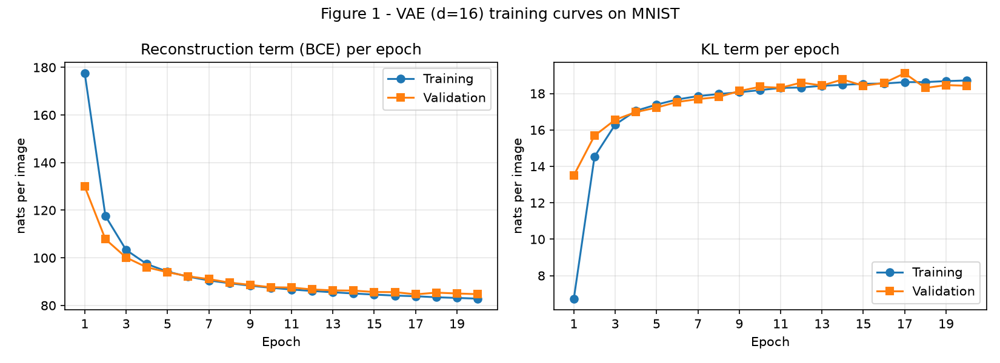
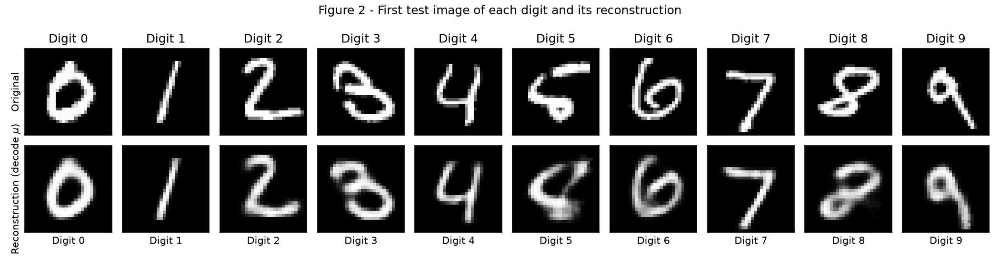
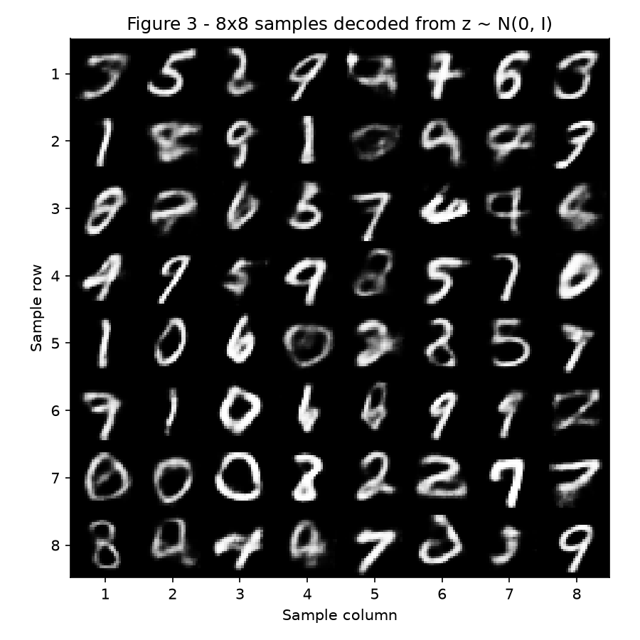
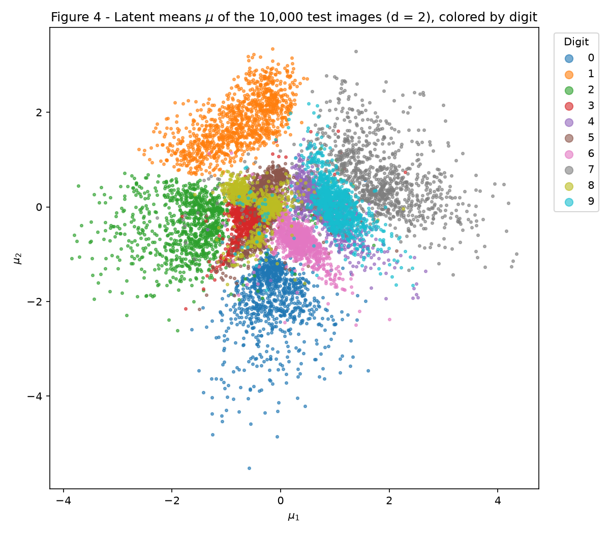
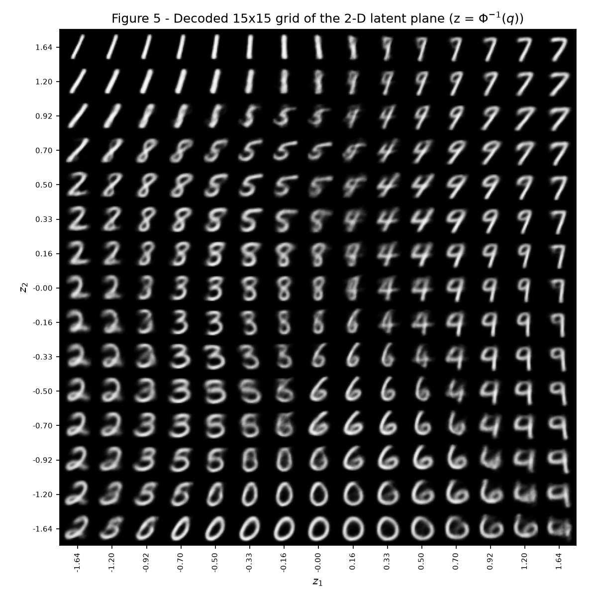
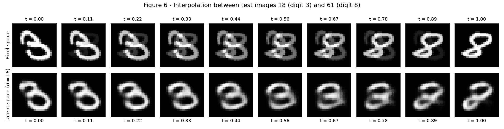

# 4. VAE

!!! info "Assignment"

    [Exercises → VAE](https://insper.github.io/ann-dl/2026.2/exercises/vae/)

## Variational Autoencoders on MNIST

This activity builds a Variational Autoencoder (VAE) in PyTorch, with the reparameterization, both terms of the loss and the sampling written by hand. The thread running through it is the tug of war inside the loss: reconstructing the input against keeping the latent space close to a prior that can be sampled. Exercise 1 trains a VAE with a 16-dimensional latent space on MNIST and logs the reconstruction and KL terms separately. Exercise 2 trains the same model with a 2-dimensional latent space, which can be drawn, to see what the prior buys and what it costs.

!!! note "How the code is organized across exercises"

    The `VAE` class and the `vae_loss` function were developed in Exercise 1 (items B and C) and are reused in Exercise 2 without any change: same architecture, same loss, same optimizer, learning rate, batch size, number of epochs, \(\beta\), data split and seeds. The only argument that changes is the latent dimension `d`.

    In Exercise 2, the Exercise 1 training loop is wrapped in a function, `train_vae(d)`, so that it can be called once with `d = 16` and once with `d = 2`. The `d = 16` model is trained again with the same recipe as in Exercise 1 and is the one used in the interpolation of item 2D. So that each script runs on its own, `code/exercise2.py` repeats the data loading, the `VAE` class and `vae_loss` verbatim at the top; those lines are not shown again in this report, which only shows the code that is new in each exercise.

## Exercise 1 - A VAE on MNIST

### A - Load and Split the Data

MNIST comes from `torchvision`, with pixels in \([0, 1]\) (`transforms.ToTensor()`), flattened into 784-vectors. The 60,000 training images are split into 50,000 for training and 10,000 for validation with a generator seeded with 42, and the 10,000 official test images are the test set.

``` python
--8<-- "exercises/vae/exercise1.py:itemA"
```

The split has 50,000 training, 10,000 validation and 10,000 test images, each an item of shape `(784,)`.

### B - Build the Model

The architecture is the one in the statement, with latent dimension \(d = 16\):

| Part    | Layers                                                                                  |
|---------|-----------------------------------------------------------------------------------------|
| Encoder | \(784 \to 512 \to 256\), ReLU after each                                                |
| Heads   | two linear layers \(256 \to d\): one for \(\mu\), one for \(\log \sigma^2\) |
| Decoder | \(d \to 256 \to 512 \to 784\), ReLU after the hidden layers, sigmoid at the output      |

With \(d = 16\) the model has 1,079,600 trainable parameters.

**Reparameterization.** Sampling \(z \sim \mathcal{N}(\mu, \sigma^2)\) directly would block the gradient. Instead, the noise is drawn separately and the sample is built from it:

\[ \mathbf{z} = \mu + \sigma \odot \varepsilon, \qquad \sigma = \exp\!\left(\tfrac{1}{2}\log \sigma^2\right), \qquad \varepsilon \sim \mathcal{N}(\mathbf{0}, I) \]

so the gradient reaches \(\mu\) and \(\log \sigma^2\) through a deterministic path. The encoder predicts \(\log \sigma^2\) and not \(\sigma\) so that the output is unconstrained and \(\sigma\) is always positive after the exponential.

**Loss.** The loss per image is the negative ELBO with a weight \(\beta = 1\) on the KL term:

\[ L = \underbrace{-\sum_{j=1}^{784} \Big[x_j \log \hat{x}_j + (1 - x_j) \log (1 - \hat{x}_j)\Big]}_{\text{reconstruction (BCE)}} \;+\; \beta \cdot \underbrace{\tfrac{1}{2}\sum_{i=1}^{d} \left(\mu_i^2 + \sigma_i^2 - 1 - \log \sigma_i^2\right)}_{\text{KL}(q(z \mid x) \,\|\, \mathcal{N}(0, I))} \]

The reconstruction term is the Bernoulli negative log-likelihood, which fits the sigmoid output and MNIST pixels that are almost all 0 or 1. It is computed with `F.binary_cross_entropy(..., reduction="sum")` divided by the batch size; `reduction="mean"` would also average over the pixels and shrink this term 784 times relative to the KL, which is the same as secretly setting \(\beta \approx 784\). The KL is the closed form for a diagonal Gaussian against the standard normal, written out in the code (no `torch.distributions.kl_divergence`). Both terms are returned separately so they can be logged. The `sample` method draws \(z \sim \mathcal{N}(0, I)\) and decodes it.

``` python
--8<-- "exercises/vae/exercise1.py:itemB"
```

### C - Train

| Setting                   | Value                                                       |
|---------------------------|-------------------------------------------------------------|
| Optimizer                 | Adam                                                        |
| Learning rate             | \(10^{-3}\)                                                 |
| Batch size                | 128 (training set shuffled every epoch)                     |
| Epochs                    | 20                                                          |
| \(\beta\)                 | 1.0                                                         |
| Latent dimension \(d\)    | 16                                                          |
| Seed                      | `torch.manual_seed(42)` before building the model           |
| Logged per epoch          | reconstruction and KL, on training (epoch average) and validation |

The training values are the average over the batches of the epoch, computed while the weights are still changing. The validation values come from one pass of the whole validation set through the model at the end of the epoch, with one sample of \(z\) per image. The test set is evaluated the same way, once, after the last epoch.

``` python
--8<-- "exercises/vae/exercise1.py:itemC"
```

Test results (\(d = 16\)), in nats per image:

| Reconstruction | KL      | Negative ELBO |
|----------------|---------|---------------|
| 84.15    | 18.49 | 102.64  |

``` python
--8<-- "exercises/vae/exercise1.py:itemC-figure"
```

[](figures/figure1.png)

*Figure 1 — Reconstruction term (BCE) and KL term per epoch, on the training and validation sets (\(d = 16\)).*

On the training set, the epoch-average reconstruction falls from 177.5 nats in the first epoch to 82.9 in the last, while the KL goes from 6.7 to 18.7 nats. So the total improves because one term gets much better while the other gets worse; the analysis in item E explains why the optimizer chooses this trade.

### D - Reconstructions and Samples

Figure 2 shows the first test image of each digit 0-9 (top row) and its reconstruction (bottom row). The reconstruction decodes \(\mu\) and does not sample \(z\).

``` python
--8<-- "exercises/vae/exercise1.py:itemD"
```

[](figures/figure2.png)

*Figure 2 — First test image of each digit and its reconstruction, decoded from \(\mu\).*

Figure 3 shows an \(8 \times 8\) grid of images decoded from \(z \sim \mathcal{N}(0, I)\), drawn after `torch.manual_seed(0)`.

``` python
--8<-- "exercises/vae/exercise1.py:itemD-figure"
```

[](figures/figure3.png)

*Figure 3 — 8×8 samples decoded from the prior \(\mathcal{N}(0, I)\).*

### E - Analysis

1. Figure 1: the KL *rises* during the first epochs while the total loss falls. Why would the optimizer choose to pay more KL?

    **A:** The KL term measures how many nats of information the code carries about each image. At initialization the encoder output is close to the prior, so the KL is almost zero but `z` says nothing about the input, and the decoder can only output a blob close to the average digit (about 543 nats of reconstruction). Making `z` informative costs KL, but it pays back far more in reconstruction. The training KL went from 6.7 to 18.7 nats over 20 epochs (about 12 nats more), while the training reconstruction fell from 177.5 to 82.9 (about 95 nats less). The optimizer minimizes the sum, so it keeps spending KL as long as one extra nat buys more than one nat of reconstruction. KL flattens around 18.5 nats because that exchange rate has reached about 1, which is where the two terms balance. A total that falls while one term rises is the optimizer choosing that trade, not a problem with training.

2. Figure 3 looks worse than Figure 2 — blurrier digits, some that are no digit at all. Give **two** separate reasons, one about *where* the prior samples land in the latent space, and one about *what* the decoder outputs for a given $z$.

    **A:** 
    - **Where the prior samples land.** The KL on the test set is not zero (about 18.5 nats), so the distribution of encoded images (the aggregate posterior) does not match N(0, I). The prior has regions where no training image was ever encoded, such as the gaps between digit clusters and the far tails. A prior sample can land there, and the decoder is extrapolating in those places. This explains samples that are no digit at all, such as the smudged ones in rows 2 and 8. Figure 2 only decodes `μ` of real images, which are always in well-covered regions.
    - **What the decoder outputs for a given `z`.** With a Bernoulli (BCE) likelihood, the best output for a given `z` is the mean of all images that could have produced that `z`, because averaging minimizes the expected loss. A single code cannot fix exact stroke position and thickness, so the decoder outputs this average and the picture is blurry. If a `z` sits between two digit modes, the average is a superposition of both, which gives the half-3, half-8 shapes. This blur is also visible in Figure 2, where the 5 and 8 reconstructions are fuzzy.

3. Why decode $\mu$ and not a sampled $z$ in Figure 2?

    **A:** `μ` is the center of the encoder's distribution q(z|x), so it is the one code that best represents that image. A sampled `z = μ + σε` adds random noise, which gives a different, usually worse image each time. The training loss does use sampled `z`, but that noise is there to regularize the latent space. For showing what the model learned about a specific image, the deterministic `μ` gives a reproducible figure without sampling noise.

## Exercise 2 - A Latent Space You Can See

With \(d = 16\) the latent space cannot be drawn. With \(d = 2\) it can, at a price that this exercise measures. Everything here reuses the `VAE` class and `vae_loss` of Exercise 1 (see the note at the top); only `d` changes.

### A - Train a 2-D VAE

`train_vae(d)` is the Exercise 1 recipe (Adam, learning rate \(10^{-3}\), batch size 128, 20 epochs, \(\beta = 1\), seed 42 before building the model) as a function of the latent dimension. It is called for `d = 16` and for `d = 2`, on the same data split.

``` python
--8<-- "exercises/vae/exercise2.py:itemA"
```

``` python
--8<-- "exercises/vae/exercise2.py:itemA-results"
```

Test results, in nats per image:

| Latent dimension | Parameters | Reconstruction | KL        | Negative ELBO |
|------------------|------------|----------------|-----------|---------------|
| \(d = 16\)       | 1,079,600  | 84.10     | 18.49 | 102.59    |
| \(d = 2\)        | 1,068,820  | 133.43     | 6.90  | 140.32    |

Going from \(d = 16\) to \(d = 2\) removes only about 1% of the parameters, but it makes the reconstruction term clearly worse (84.10 → 133.43 nats, about 49 nats more) and cuts the KL from 18.49 to 6.90 nats: the code can carry far fewer nats. The negative ELBO rises from 102.59 to 140.32 nats.

The \(d = 16\) model is trained again here with the same seed and recipe as in Exercise 1, and its validation curve is identical epoch by epoch. Its test reconstruction is 84.10 here against 84.15 in Exercise 1 (the KL is 18.49 in both). The small difference comes from the evaluation, which draws one random \(z\) per image from a generator that is in a different state in this script, because the \(d = 2\) model is trained afterwards in the same run.

### B - The Encoded Test Set

Figure 4 shows \(\mu\) for all 10,000 test images with \(d = 2\), colored by digit.

``` python
--8<-- "exercises/vae/exercise2.py:itemB"
```

[](figures/figure4.png)

*Figure 4 — Latent means \(\mu\) of the 10,000 test images (\(d = 2\)), colored by digit.*

### C - The Decoded Plane

The grid is not spaced linearly. The 15 values of each axis are \(z = \Phi^{-1}(q)\), with \(q\) running over 15 evenly spaced values in \([0.05, 0.95]\) and \(\Phi^{-1}\) the inverse CDF of \(\mathcal{N}(0, 1)\) (`scipy.stats.norm.ppf`). This spacing gives every cell the same prior mass because consecutive grid values are separated by the same step in cumulative probability, so each interval holds the same share of the \(\mathcal{N}(0, 1)\) mass on each axis, and the cells of the 2-D grid, being products of two such intervals, hold the same share of \(\mathcal{N}(0, I)\).

``` python
--8<-- "exercises/vae/exercise2.py:itemC"
```

[](figures/figure5.png)

*Figure 5 — Decoded 15×15 grid of the 2-D latent plane (\(z = \Phi^{-1}(q)\)); \(z_2\) decreases from top to bottom.*

### D - Interpolation

The two test images are the first 3 and the first 8 of the test set: test index 18 (digit 3) and test index 61 (digit 8). The top row of Figure 6 interpolates in pixel space, \((1 - t)\,\mathbf{x}_a + t\,\mathbf{x}_b\). The bottom row interpolates in latent space with the \(d = 16\) model of Exercise 1: it decodes \((1 - t)\,\mu_a + t\,\mu_b\), for 10 values of \(t\) from 0 to 1.

``` python
--8<-- "exercises/vae/exercise2.py:itemD"
```

[](figures/figure6.png)

*Figure 6 — Interpolation between test images 18 (digit 3) and 61 (digit 8): pixel space (top) and latent space with \(d = 16\) (bottom).*

### E - Analysis

1. Which digits overlap in Figure 4? Find the same transition in Figure 5 and describe what the in-between images look like.

    **A:** Digits 1, 0, 2 and 7 form fairly distinct regions: 1 at the top, 0 at the bottom, 2 on the left and 7 on the right. The heavy overlap is in the center: 3, 5 and 8 (red, brown and olive) sit on top of each other near the origin. Digits 4 and 9 (purple and cyan) overlap just to the right of that, and 9 also touches the lower part of the 7 cloud.

    In Figure 5, the 4 → 9 transition is around `z₁` between about 0.3 and 0.7, for `z₂` from about −0.3 to 0.7. There the images change from a clear 4 to a clear 9. The in-between cells are smudged hybrids with the top stroke half open and half closed, so they are neither digit. The 3, 5 and 8 blocks sit left of center. There the in-between images are blurry blends with mixed loops, such as an 8 whose lower loop is opening into a 3, or a 5 and an 8 sharing strokes. No single sharp digit appears between the two clear regions.

2. $d = 2$ reconstructs clearly worse than $d = 16$. What does two numbers per image force the model to throw away? Use Figure 5 as evidence.

    **A:** Two numbers can carry only a few nats (the d = 2 KL is much lower than the d = 16 value of about 18.5), so the code keeps the coarse information: which digit it is, plus a couple of style factors. Fine detail has to go: exact stroke width, curvature, loop shapes and small variations within a digit. Figure 5 shows this. Each region of the plane is one prototype digit that changes smoothly in slant or width (for example, the 1s tilt gradually across the top-left), with the same smooth look everywhere and no fine detail. Different handwriting styles of the same digit must share nearby codes, so the decoder outputs their blurry average. That is why the reconstruction term is clearly worse than at d = 16. Please add your measured test numbers from item A here (the expected values are about 135 against 84 nats of reconstruction).

3. Compare the two rows of Figure 6. Which one passes through images that look like digits, and why does the other one not?

    **A:** The latent-space row (bottom) is the one that passes through digit-like images, though not perfectly. Every frame is a single coherent shape that morphs from the 3 into the 8, with its slant and loops changing gradually. The frames around t = 0.6 to 0.8 are smeared, which matches the blurry boundary regions in Figure 5, but each one is still one stroke pattern.

    The pixel-space row (top) never gives a digit between the endpoints. Each frame is a cross-fade, with a faint 3 and a faint 8 overlaid at different positions. That is two images stacked, not one digit.

    The reason is geometry. Valid digit images lie on a thin, curved surface in the 784-dimensional pixel space, and the straight line between two of them leaves that surface. Averaging pixel intensities does not give a digit. The VAE decoder can only produce images from the region of latent space it was trained on, and the latent space is pushed toward a smooth Gaussian shape. A straight line between two `μ` values therefore stays inside a region the decoder knows, and every point on it decodes to a plausible digit-like image.

## Results Summary

| \# | Quantity                                                       | Value                                                                              |
|----|----------------------------------------------------------------|------------------------------------------------------------------------------------|
| 1  | Ex. 1 — test reconstruction, KL and negative ELBO (\(d = 16\)) | reconstruction **84.15**; KL **18.49**; negative ELBO **102.64** (nats per image)  |
| 2  | Ex. 1 — validation KL at the first and at the last epoch       | epoch 1: **13.51**; epoch 20: **18.43** (nats per image)                           |
| 3  | Ex. 2 — test reconstruction and KL (\(d = 2\))                 | reconstruction **133.43**; KL **6.90** (nats per image)                            |
| 4  | Ex. 2 — the two test indices interpolated                      | 18 (digit 3) and 61 (digit 8)                                                      |