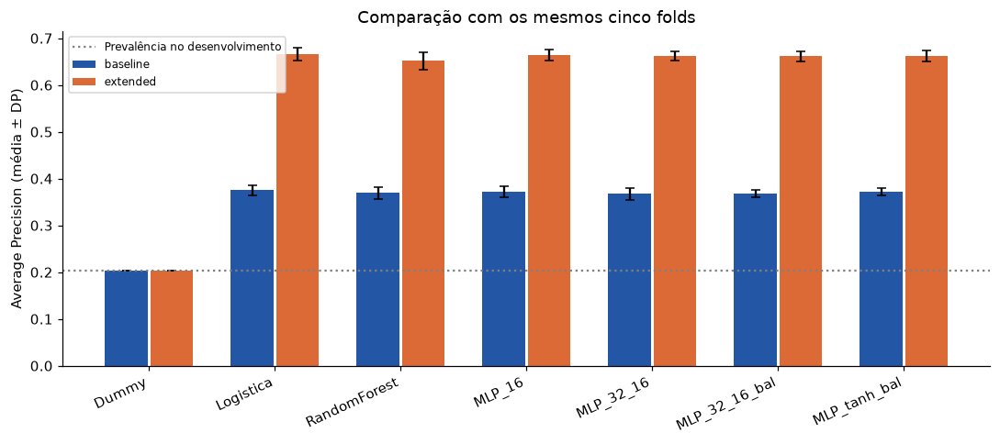
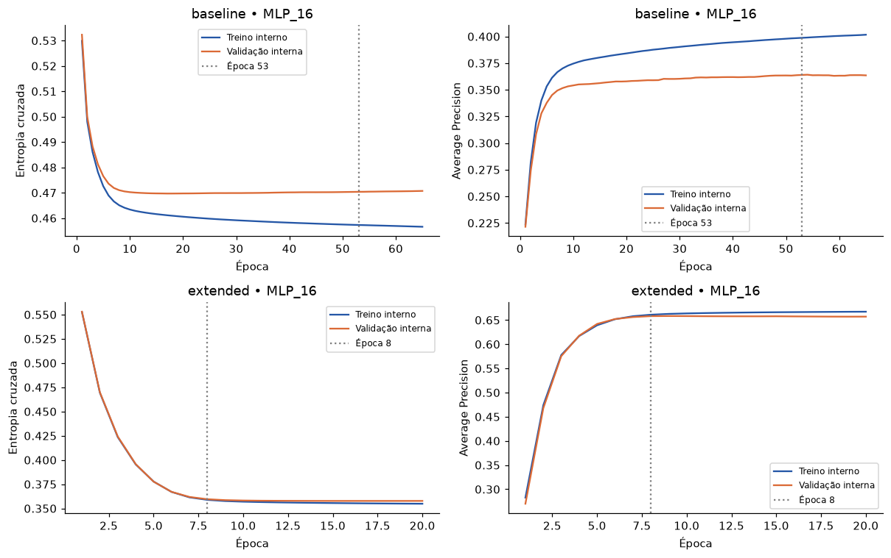
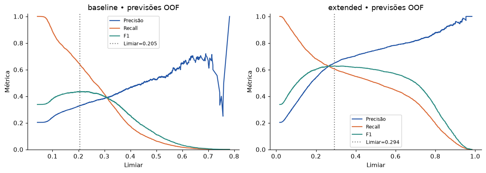
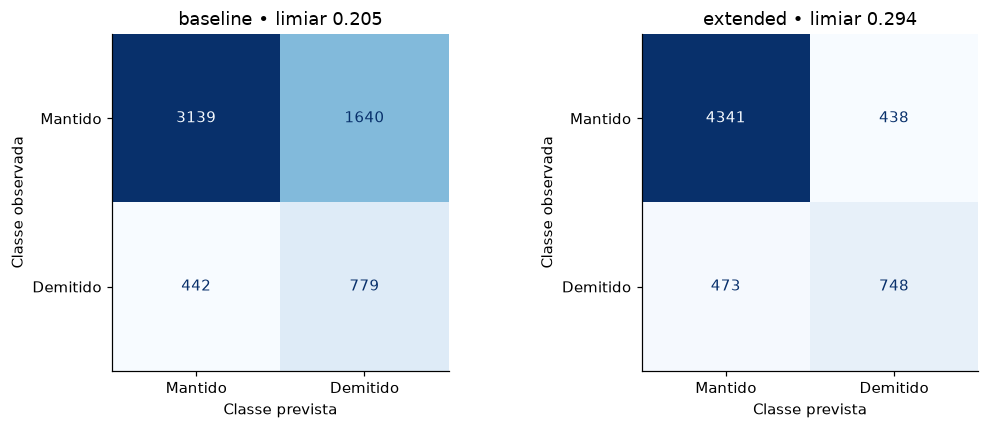
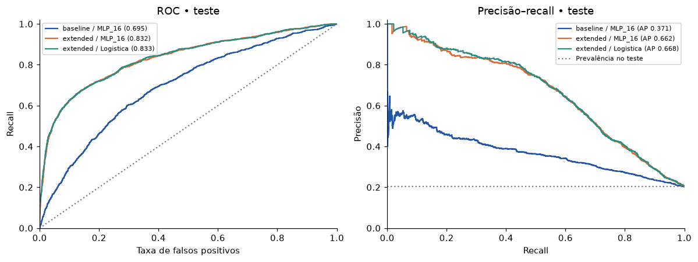
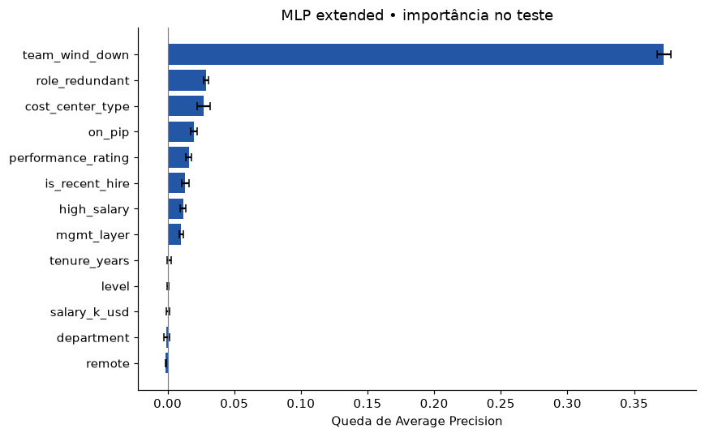

# 2. Classification — Layoff Survival

!!! abstract "Assignment"

    [Projects → Classification or Regression](https://insper.github.io/ann-dl/2026.2/projects/supervised/){:target='_blank'}

## Layoff Survival: Who Actually Gets Cut?

This report continues the [exploratory data analysis (EDA)](https://giuvallente.github.io/neuralNetworks-Documentation/project/eda/) of Sergey Nefedov's [synthetic Kaggle dataset](https://www.kaggle.com/datasets/sergionefedov/layoff-survival-who-actually-gets-cut). The task is binary classification of `laid_off` (`1` = selected for a layoff; `0` = retained). The central comparison is whether a multilayer perceptron (MLP) improves on simpler models and whether organizational attributes change the result. All numbers below are taken from the supplied executed notebook; the data describe a synthetic mechanism, not actual employees.

## Step 0 · Starting point

**Data and split.** The EDA established 30,000 records and 15 original columns. The target has 6,107 positives (20.36%) and 23,893 negatives (79.64%). The same stratified split with seed 42 reserves 6,000 records (1,221 positives) for the test set and uses 24,000 (4,886 positives) for development. Five stratified folds each use 19,200 records for training and 4,800 for validation. The `baseline` feature set contains 10 original predictors; `extended` adds `team_wind_down`, `cost_center_type`, and `role_redundant`, for 13. This `baseline` is broader than the dataset author's three-variable example.

**Preprocessing.** `employee_id` is removed from the predictors and `laid_off` becomes the target. Within each fold, a `ColumnTransformer` imputes and standardizes continuous variables, imputes text categories and applies one-hot encoding with `handle_unknown='ignore'`, and imputes binary indicators. It is fitted only on the training portion; the inner early-stopping split has its own training-only fit. The first fold yields `(19200, 24)` train and `(4800, 24)` validation matrices for `baseline`, and `(19200, 29)` and `(4800, 29)` for `extended`, with finite entries. The final models fit a fresh preprocessor on the 24,000 development records and transform the held-out test records. PCA, t-SNE, and UMAP were diagnostic tools in the EDA and are not classifier inputs.

**Primary metric and criterion.** Average Precision (AP) summarizes the precision–recall curve without fixing a threshold. It is appropriate to foreground the minority positive class, while reporting precision, recall, F1, and ROC-AUC alongside it. The code establishes AP as the main metric before training, but does not state a numeric success criterion against the best baseline before training. A 15% AP improvement can be calculated as a retrospective comparison, not claimed as a predeclared criterion. The dummy prevalence reference is approximately 0.2036 AP on development.

``` { .python .copy .select linenums="1" }
   --8<-- "neuralNetworks-Project/codeDocumentation/classificacao_layoff_survival.py:install"
```

``` { .python .copy .select linenums="1" }
   --8<-- "neuralNetworks-Project/codeDocumentation/classificacao_layoff_survival.py:load"
```

``` { .python .copy .select linenums="1" }
   --8<-- "neuralNetworks-Project/codeDocumentation/classificacao_layoff_survival.py:features"
```

``` { .python .copy .select linenums="1" }
   --8<-- "neuralNetworks-Project/codeDocumentation/classificacao_layoff_survival.py:split"
```

## Step 1 · Baselines

Three references were evaluated on the same five folds and preprocessing protocol as the MLP: `DummyClassifier(strategy='prior')`, logistic regression (`C=1.0`, `max_iter=1000`), and a Random Forest (150 trees, maximum depth 10, minimum leaf size 15, balanced class weights). `prior` predicts the observed class prior as a score and the majority class at threshold 0.5; it supplies the trivial reference requested by the assignment. Logistic regression tests whether a linear decision rule suffices. The forest provides a non-neural nonlinear reference.

The table below reports the mean ± standard deviation across five validation folds. AP was computed from scores before selecting a classification threshold.

| Feature set | Dummy AP | Logistic AP | Random Forest AP | Best baseline |
|---|---:|---:|---:|---|
| `baseline` | 0.2036 ± 0.0001 | **0.3752 ± 0.0104** | 0.3692 ± 0.0132 | Logistic regression |
| `extended` | 0.2036 ± 0.0001 | **0.6669 ± 0.0138** | 0.6517 ± 0.0183 | Logistic regression |

The large gain from `baseline` to `extended` also appears for logistic regression (0.3752 → 0.6669), so it cannot be attributed specifically to the MLP. The near-0.20 dummy AP and its zero positive recall at threshold 0.5 show why accuracy alone would hide failure on the minority class.



*Figure 1. Mean AP ± fold standard deviation for the three reference models and four MLP settings on both feature sets. The dotted line marks positive prevalence in development.*

## Step 2 · The network

The tested classifier is a fully connected scikit-learn MLP with either one hidden layer of 16 units or two hidden layers of 32 and 16 units. Configurations use ReLU or tanh, a single sigmoid output for the binary class, and binary cross-entropy optimization. `alpha` controls L2 penalization. Seeds initialize the estimator for reproducibility; the notebook does not explicitly select or justify an initialization scheme. The compact widths limit capacity relative to the 19,200 outer-fold training rows, while the two-layer alternatives test whether more depth helps.

For the selected `MLP_16` (`16` hidden ReLU units, `alpha=0.001`, no class weights), the fitted one-hot input has 29 columns in `extended`. Its two dense layers contain 497 parameters: `(29 × 16 + 16) + (16 × 1 + 1)`. The same architecture has 417 parameters with the 24-column `baseline` input. The extended parameter count is about 2.6% of an outer-fold training set of 19,200 rows. The estimator internally handles initialization, activation, output, loss, and gradients; these are not an independently implemented training loop in `code/`.

| Configuration | Hidden layers | Activation | L2 `alpha` | Class weighting |
|---|---|---|---:|---|
| `MLP_16` | 16 | ReLU | 0.001 | None |
| `MLP_32_16` | 32 → 16 | ReLU | 0.01 | None |
| `MLP_32_16_bal` | 32 → 16 | ReLU | 0.01 | Inverse class frequency |
| `MLP_tanh_bal` | 32 → 16 | tanh | 0.01 | Inverse class frequency |

Weights for a weighted run are recalculated on its own training subset as $w_c=n/(2n_c)$. They do not use validation or test class frequencies. Class weighting addresses imbalance; it is not a second regularization technique.

``` { .python .copy .select linenums="1" }
   --8<-- "neuralNetworks-Project/codeDocumentation/classificacao_layoff_survival.py:models"
```

## Step 3 · Training

The MLP uses Adam, initial learning rate 0.001, batch size 256, and at most 100 epochs. Adam and a moderate batch size provide a practical optimization baseline for this small tabular network; the notebook does not compare optimizers or learning rates separately. An inner stratified 15% validation split is taken exclusively from each outer training fold. Its preprocessing is learned on the other 85%. After each epoch, the inner validation AP is monitored; early stopping waits **12 epochs** without an improvement greater than 0.0005. The best epoch is recorded, the inner model is discarded, and a newly initialized MLP is trained for exactly that many epochs on the full outer training fold. This retraining uses the selected epoch rather than restoring a saved set of inner-model weights.

``` { .python .copy .select linenums="1" }
   --8<-- "neuralNetworks-Project/codeDocumentation/classificacao_layoff_survival.py:cv"
```

For `MLP_16`, the selected epochs across the five folds were `[53, 13, 11, 25, 19]` on `baseline` and `[8, 15, 14, 19, 9]` on `extended`. Their medians, 19 and 14 epochs, were fixed for the final development-set refits. Figure 2 shows the predetermined first fold's inner training and validation curves; the cross-entropy curves exclude the L2 penalty and are shown for diagnosis, while AP determines the stopping epoch.


``` { .python .copy .select linenums="1" }
   --8<-- "neuralNetworks-Project/codeDocumentation/classificacao_layoff_survival.py:learning_curves"
```



*Figure 2. Inner training and validation cross-entropy (left) and AP (right) for the selected MLP on fold 1. Dotted lines mark epochs 53 (`baseline`) and 8 (`extended`).*

Both feature sets improve quickly and then level off. On the first `baseline` fold, validation cross-entropy flattens near epoch 10 and later drifts upward while training loss keeps falling; validation AP changes little beyond its peak near epoch 53. At that selected epoch, training AP is **0.3988** and inner validation AP **0.3639**, suggesting a modest generalization gap. On `extended`, validation loss and AP nearly coincide with training through the early plateau; at epoch 8, AP is **0.6610** in training and **0.6581** in validation. These curves show one inner split, not every fold and not the final test.

## Step 4 · Regularization and hyperparameters

Four MLP configurations were evaluated on each of two feature sets, producing eight MLP/feature-set comparisons. The table is sorted by mean validation AP; all entries use the same five folds. Selection of the MLP architecture was made using `extended` only: `MLP_16` had the highest mean MLP AP (**0.6643 ± 0.0120**). It was then applied unchanged to `baseline` to compare feature sets. The best combination among *all* models was `extended` logistic regression (**0.6669 ± 0.0138**), not the MLP.

| Rank | Feature set | MLP configuration | Mean CV AP ± SD | Mean CV ROC-AUC ± SD |
|---:|---|---|---:|---:|
| 1 | `extended` | `MLP_16` | **0.6643 ± 0.0120** | 0.8354 ± 0.0115 |
| 2 | `extended` | `MLP_tanh_bal` | 0.6625 ± 0.0117 | 0.8351 ± 0.0103 |
| 3 | `extended` | `MLP_32_16` | 0.6619 ± 0.0104 | 0.8346 ± 0.0084 |
| 4 | `extended` | `MLP_32_16_bal` | 0.6618 ± 0.0108 | 0.8348 ± 0.0089 |
| 5 | `baseline` | `MLP_16` | 0.3723 ± 0.0115 | 0.6971 ± 0.0071 |
| 6 | `baseline` | `MLP_tanh_bal` | 0.3721 ± 0.0077 | 0.6975 ± 0.0070 |
| 7 | `baseline` | `MLP_32_16_bal` | 0.3681 ± 0.0078 | 0.6946 ± 0.0066 |
| 8 | `baseline` | `MLP_32_16` | 0.3672 ± 0.0127 | 0.6951 ± 0.0069 |

``` { .python .copy .select linenums="1" }
   --8<-- "neuralNetworks-Project/codeDocumentation/classificacao_layoff_survival.py:choose_mlp"
```

The deeper or class-weighted alternatives did not produce a meaningful AP gain over `MLP_16`; their CV differences are small next to fold-to-fold variation. L2 was used at `alpha=0.001` or `0.01`; no `alpha=0` network, dropout, normalization layer, or independently varied learning rate appears in the supplied experiments. Therefore eight rows are not eight distinct hyperparameter configurations, and neither a no-regularization control nor two isolated regularization techniques were demonstrated. The current work does not fully satisfy Step 4 of the assignment.

**Feature sensitivity.** With the selected `MLP_16`, extra development-only experiments obtained AP **0.6592 ± 0.0123** for `extended` without `is_recent_hire` and `high_salary`, **0.3609 ± 0.0154** for a conservative set without structural variables or `on_pip`, and **0.2716 ± 0.0169** for the author's original three-feature set. They are exploratory comparisons, not test results; removing derived indicators changed mean AP by only **−0.0051** relative to `extended` (0.6592 − 0.6643). The structural-feature gain still requires a prediction-time availability check.


``` { .python .copy .select linenums="1" }
   --8<-- "neuralNetworks-Project/codeDocumentation/classificacao_layoff_survival.py:sensitivity"
```

## Step 5 · Test evaluation

**Frozen decisions.** Before using test labels, the notebook fixed `MLP_16` from CV, set final epochs to the median fold selections, and chose each classification threshold to maximize F1 on out-of-fold development predictions. For the MLP, the thresholds were **0.2048** (`baseline`) and **0.2935** (`extended`). The best threshold differs from 0.5 because the positive class is the minority and F1 rewards a particular precision–recall balance. This F1 rule is an academic convention; real costs of false accusations and missed layoffs were not supplied. The OOF F1 at the optimized threshold is part of tuning and is not an unbiased test result. AP and ROC-AUC are computed from continuous scores and do not depend on that threshold.

``` { .python .copy .select linenums="1" }
   --8<-- "neuralNetworks-Project/codeDocumentation/classificacao_layoff_survival.py:thresholds"
```



*Figure 3. Precision, recall, and F1 versus threshold on out-of-fold development predictions for the selected MLP; dotted lines mark the selected thresholds.*

After these choices, the pipelines were refitted on all **24,000 development rows** and evaluated on the **6,000 reserved test rows**. The table puts the network and reference models on that same test set. Precision, recall, and F1 refer to class `1` at the frozen threshold; AP and ROC-AUC use continuous scores. All values below come from the notebook's saved test output.

| Feature set | Model | Frozen threshold | AP ↑ | ROC-AUC ↑ | Precision (1) ↑ | Recall (1) ↑ | F1 (1) ↑ | Accuracy |
|---|---|---:|---:|---:|---:|---:|---:|---:|
| `baseline` | Dummy | 0.5000 | 0.2035 | 0.5000 | 0.0000 | 0.0000 | 0.0000 | 0.7965 |
| `baseline` | Logistic | 0.2213 | **0.3742** | 0.6982 | 0.3367 | 0.5921 | 0.4293 | 0.6797 |
| `baseline` | Random Forest | 0.5225 | 0.3603 | 0.6909 | 0.3478 | 0.5700 | 0.4320 | 0.6950 |
| `baseline` | MLP_16 | 0.2048 | 0.3706 | 0.6950 | 0.3220 | 0.6380 | 0.4280 | 0.6530 |
| `extended` | Dummy | 0.5000 | 0.2035 | 0.5000 | 0.0000 | 0.0000 | 0.0000 | 0.7965 |
| `extended` | Logistic | 0.3133 | **0.6676** | 0.8330 | 0.6458 | 0.5987 | 0.6213 | 0.8515 |
| `extended` | Random Forest | 0.6014 | 0.6396 | 0.8285 | 0.6479 | 0.5938 | 0.6197 | 0.8517 |
| `extended` | MLP_16 | 0.2935 | 0.6623 | 0.8319 | 0.6307 | 0.6126 | **0.6215** | 0.8482 |

**Per-class metrics for the selected `extended` MLP:** on the 4,779 retained employees, precision = **0.9017**, recall = **0.9083**, F1 = **0.9050**; on the 1,221 laid-off employees, precision = **0.6307**, recall = **0.6126**, F1 = **0.6215**. Macro F1 = **0.7633** and balanced accuracy = **0.7605**. Its confusion matrix contains **4,341 TN, 438 FP, 473 FN, and 748 TP**. The `baseline` MLP has 3,139 TN, 1,640 FP, 442 FN, and 779 TP. Thus, at these separately chosen thresholds, the structural attributes sharply reduce false positives (1,640 → 438), while the `extended` MLP misses 31 more positive cases (442 → 473). These are descriptive comparisons, not effects attributable to a single variable.

``` { .python .copy .select linenums="1" }
   --8<-- "neuralNetworks-Project/codeDocumentation/classificacao_layoff_survival.py:confusion_roc_pr"
```



*Figure 4. Test confusion matrices for the selected MLP on `baseline` and `extended`, using thresholds fixed from out-of-fold predictions.*



*Figure 5. Test ROC and precision–recall curves for the two selected MLP feature sets and extended logistic regression; the PR reference line is test prevalence (20.35%).*

The notebook reports **Average Precision**, which summarizes the PR curve; it does not separately compute trapezoidal area under that curve. The `extended` MLP improves AP over its own `baseline` version by **0.2916** (0.6623 − 0.3706), but its AP is **0.0053 below** the best simple comparator, extended logistic regression (0.6676). This is about **0.8% lower** than that comparator, so a retrospective benchmark of a ≥15% improvement over the best baseline is not met. Since no such criterion was declared before training, it cannot be reported as a successful predeclared test.

``` { .python .copy .select linenums="1" }
   --8<-- "neuralNetworks-Project/codeDocumentation/classificacao_layoff_survival.py:bootstrap"
```

**Uncertainty.** A stratified, paired bootstrap of **1,000 test-record resamples** yields a 95% percentile interval **[0.6369, 0.6861]** for extended MLP AP and **[0.2644, 0.3177]** for the extended-minus-baseline MLP AP difference. These intervals keep the fitted models fixed and do not measure retraining variability. The notebook contains one seed family (seed 42, with deterministic fold offsets), not three independent final training seeds; therefore the required test AP mean ± standard deviation over at least three seeds cannot be reported**. The five-fold standard deviations and bootstrap intervals are not substitutes for that experiment. No paired uncertainty interval was calculated for the tiny MLP-versus-logistic difference.

## Step 6 · Error analysis

Figure 4 shows the overall error trade-off. For the selected extended MLP, **473 of 1,221 actual positives were missed** and **438 of 4,779 actual negatives were flagged**. The following subgroup results use the original test-set `department` and the frozen threshold; they describe conditional error rates, not equal-sized populations.

| Department | Test rows | Actual positives | False negatives | Recall (1) | False-positive rate |
|---|---:|---:|---:|---:|---:|
| data | 353 | 50 | 33 | **0.3400** | 0.0462 |
| engineering | 1,468 | 183 | 102 | 0.4426 | 0.0529 |
| sales | 1,009 | 131 | 69 | 0.4733 | 0.0444 |
| product | 598 | 73 | 38 | 0.4795 | 0.0648 |
| support | 723 | 174 | 64 | 0.6322 | 0.1202 |
| marketing | 571 | 146 | 52 | 0.6438 | 0.0871 |
| g_and_a | 456 | 170 | 42 | 0.7529 | 0.1853 |
| recruiting | 332 | 123 | 31 | 0.7480 | **0.2440** |
| research | 490 | 171 | 42 | 0.7544 | 0.2382 |

`data` has the lowest positive recall: **17/50** positive cases detected, with **33/50 (66%)** missed. Recruiting has the largest false-positive rate, **51/209 = 24.40%** among actual negatives. These patterns may reflect different departmental base rates and the model's use of related organizational features rather than a genuine difference in model quality for people; sample sizes and errors should be checked again in independent data. The supplied notebook does not rank individual mistakes or display the worst examples, so no such case-level evidence can be asserted here.

``` { .python .copy .select linenums="1" }
   --8<-- "neuralNetworks-Project/codeDocumentation/classificacao_layoff_survival.py:importance"
```

Permutation importance was computed after the frozen test evaluation, using ten permutations of each original input column and measuring the mean drop in AP. This diagnostic did not change feature selection or tuning.

| Original feature | Mean AP drop | Permutation SD |
|---|---:|---:|
| `team_wind_down` | **0.3723** | 0.0052 |
| `role_redundant` | 0.0290 | 0.0017 |
| `cost_center_type` | 0.0268 | 0.0048 |
| `on_pip` | 0.0199 | 0.0024 |
| `performance_rating` | 0.0158 | 0.0021 |
| `is_recent_hire` | 0.0132 | 0.0028 |



*Figure 6. Mean change in test AP when each original column is permuted ten times for the selected extended MLP; bars show variation across permutations.*

This ordering broadly agrees with EDA Figure 4: `team_wind_down` showed a **73.28%** layoff rate for flagged teams against **11.57%** for unflagged teams. It is also far more important than the other columns in the fitted model. A permutation drop measures predictive reliance, **not a causal effect**. Derived, correlated, or jointly defined features can redistribute importance; a near-zero or slightly negative value is not proof that a feature is useless in every model.

## Step 7 · Conclusion

The measured gain is primarily about the feature set, rather than network complexity. On the reserved test set, the `extended` MLP obtains AP **0.6623**, versus **0.3706** without the three structural variables, but the simpler extended logistic model obtains **0.6676**. The network therefore does not show an advantage over the best simple comparator on the primary metric in this run. Its positive-class F1 (**0.6215**) is almost identical to logistic regression's (**0.6213**) at their respective development-selected thresholds. A compact linear model is at least as compelling for this particular synthetic dataset, conditional on feature availability.

The most consequential practical limitation is prediction-time leakage. `team_wind_down`, `cost_center_type`, `role_redundant`, and potentially `on_pip` must be known before a prediction would be made; the dataset and notebook do not establish that timing. The data are synthetic, and the EDA inspected the complete dataset before this reserved-test experiment. Four test profiles exactly match feature profiles in development, despite distinct employee IDs. None of these results establishes validity for employment decisions about real people. False positives could unfairly label a retained employee as at risk; false negatives could omit someone who would be affected. With more time, a defensible next study would define the prediction time and real-world error costs, remove unavailable fields, collect an independent temporal or external dataset, repeat training across multiple seeds, check calibration, and implement the required team-written network with isolated regularization comparisons. No competition submission is claimed.

``` { .python .copy .select linenums="1" }
   --8<-- "neuralNetworks-Project/codeDocumentation/classificacao_layoff_survival.py:conclusions"
```

### Results summary

| # | Summary | Value |
|---:|---|---|
| 1 | Dataset, task, target and main metric | Layoff Survival, synthetic binary classification; `laid_off = 1` positive; **Average Precision (AP)** |
| 2 | Train · validation · test (rows) | **19,200 · 4,800 · 6,000** per CV fold; development total **24,000**, stratified 5-fold; seed 42 |
| 3 | Best baseline and its test metric | **Extended logistic regression, AP 0.6676** (ROC-AUC 0.8330) |
| 4 | Chosen network: layers × units, parameters, regularization | **29 → 16 ReLU → 1 sigmoid; 497 parameters; L2 `alpha=0.001`, no class weighting**; implemented with `sklearn.MLPClassifier` (ineligible as required network) |
| 5 | Optimizer, learning rate, batch and epoch it stopped at | **Adam; 0.001; 256; final refit 14 epochs** (median of extended folds 8, 15, 14, 19, 9); inner fold 1 selected epoch 8 |
| 6 | Network main test metric (mean ± SD, 3 seeds) | **AP 0.6623 for one final seed/run**; three-seed mean ± SD **not measured** |
| 7 | Success criterion met? | **No predeclared numeric criterion.** The MLP is 0.0053 AP below the best baseline; a retrospective ≥15% improvement is **not met** |
| 8 | Subgroup with largest error and its value | **`data`: 33/50 positives missed (66% false-negative rate, recall 0.3400)**; highest false-positive rate: `recruiting`, 51/209 = 24.40% |


``` { .python .copy .select linenums="1" }
   --8<-- "neuralNetworks-Project/codeDocumentation/classificacao_layoff_survival.py:predict_synthetic"
```
