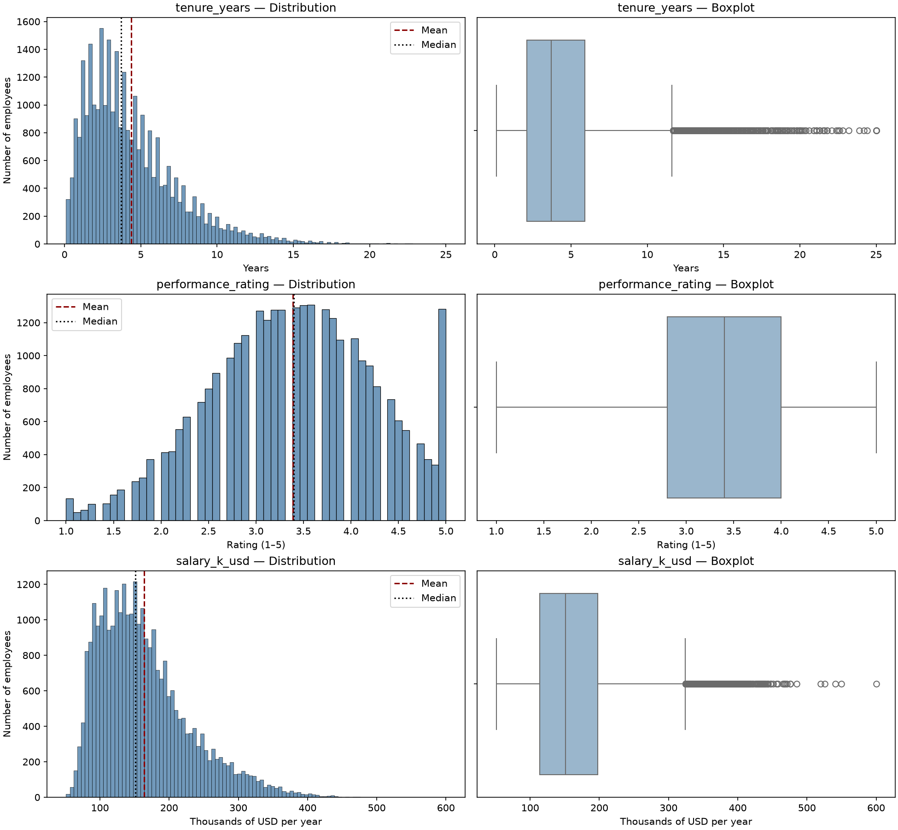
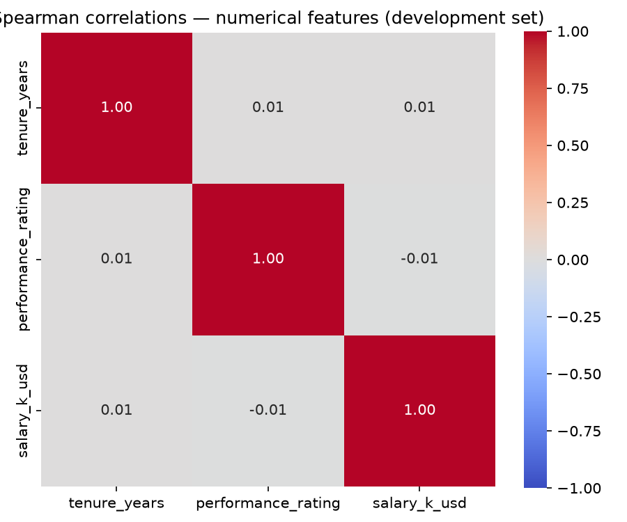
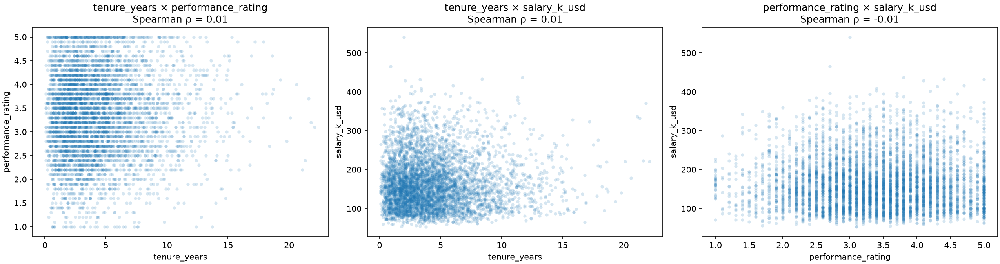
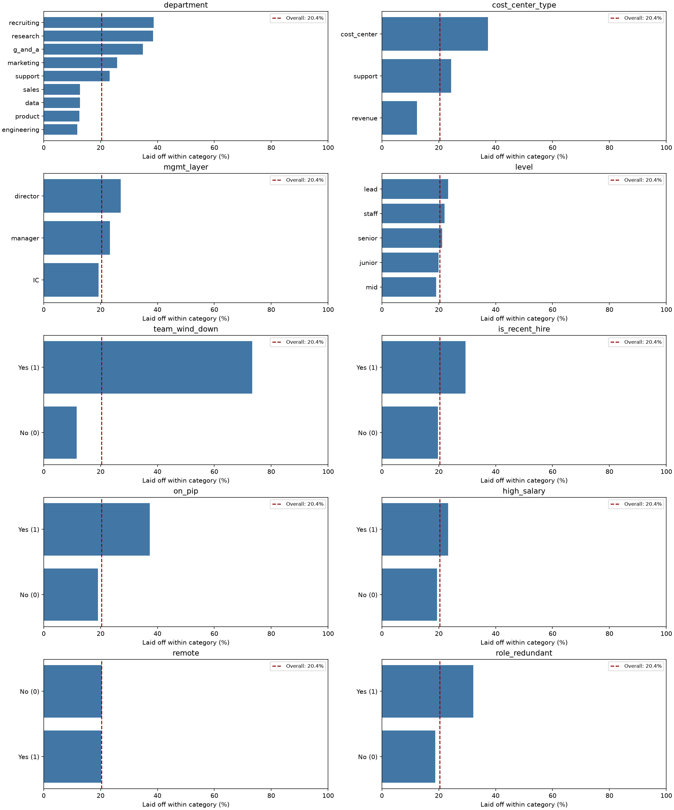
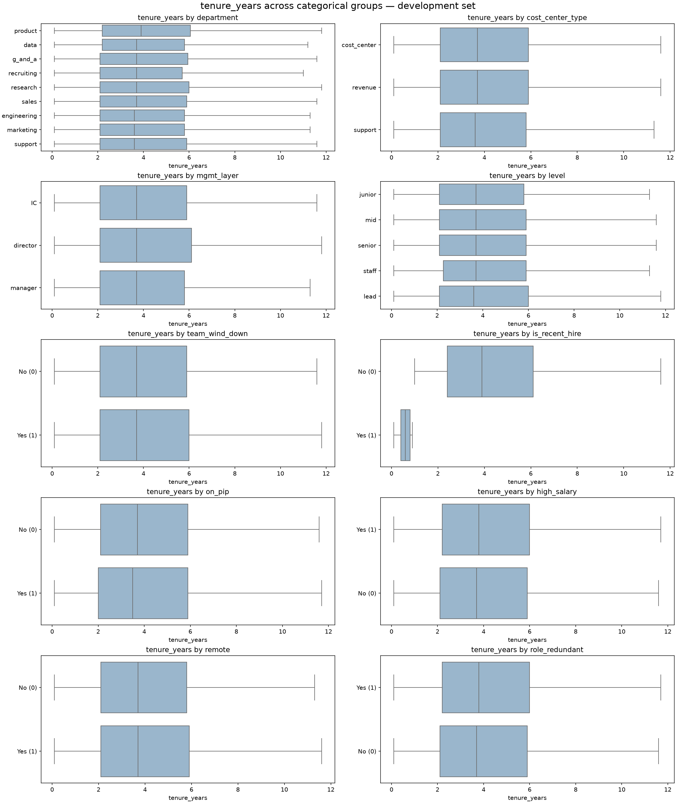
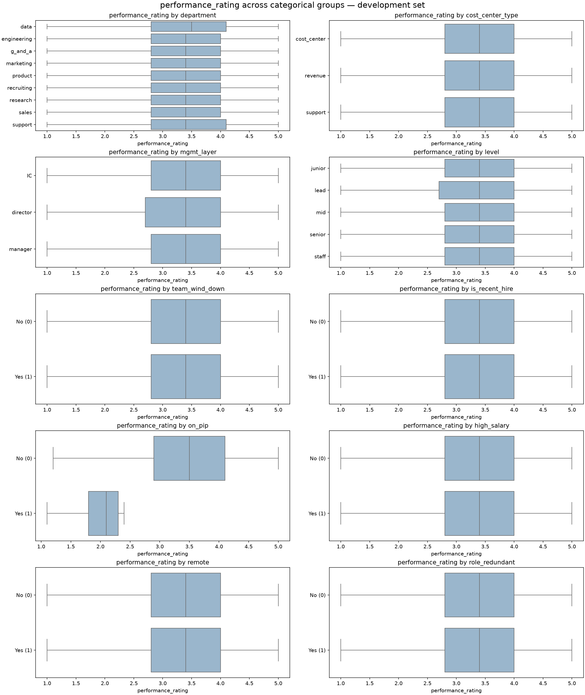
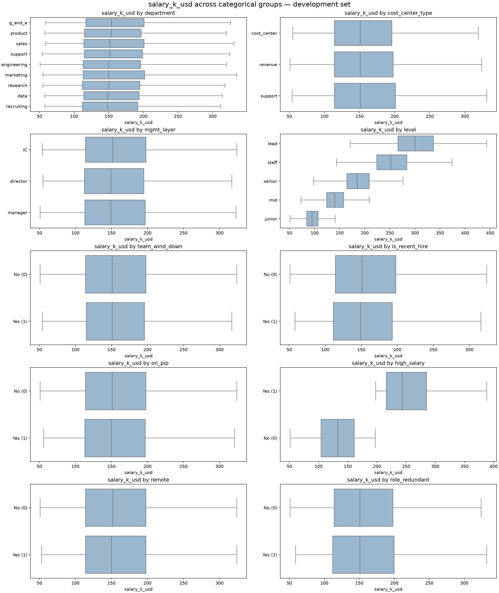
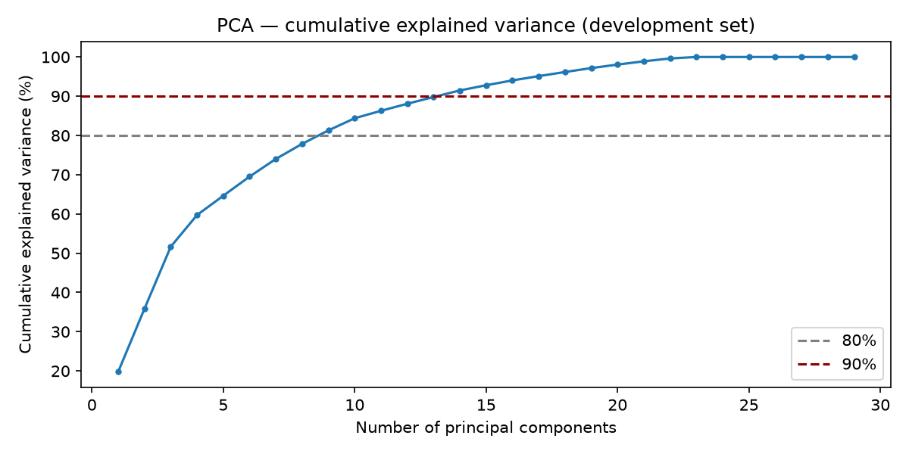
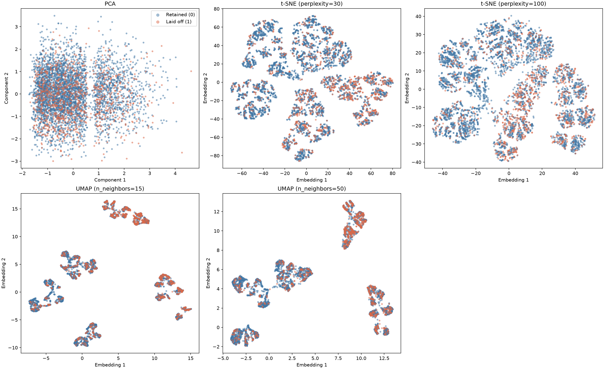

# 1. Exploratory Data Analysis

!!! abstract "Assignment"

    [Projects → EDA](https://insper.github.io/ann-dl/2026.2/projects/eda/){:target='_blank'}

## Layoff Survival: Who Actually Gets Cut?

This report presents the exploratory data analysis (EDA) of the *Layoff Survival — Who Actually Gets Cut?* dataset, which will be used in the classification deliverable of the project. The task is to predict, for each simulated employee, whether they were selected for a company-wide layoff (`laid_off`). No model is trained here: the goal is to understand the data, identify the difficulties it presents, and finish with a preprocessing pipeline ready for a neural network.

## Stage 1: Initial Inspection

### A. Data Dictionary

**Dataset Source.** The dataset was published on Kaggle by Sergey Nefedov. It contains **30,000 synthetic employee records** representing a company-wide layoff in which approximately 20% of employees were cut. The records are simulated, not real layoffs.

**What each row represents.** Each row is one simulated employee, with their attributes and the layoff outcome.

``` { .python .copy .select linenums="1" }
   --8<-- "neuralNetworks-Project/codeDocumentation/eda.py:download"
```

The file has 30,000 rows and 15 columns. 

``` { .python .copy .select linenums="1" }
   --8<-- "neuralNetworks-Project/codeDocumentation/eda.py:itemA1"
```
The table below documents the meaning, type, and unit of each column.

| Feature | Meaning | Type | Unit / values |
|---|---|---|---|
| `employee_id` | Unique employee identifier | String (identifier) | No unit |
| `department` | Employee's department | Categorical string | `engineering`, `sales`, `product`, `marketing`, `recruiting`, `support`, `g_and_a`, `research`, `data` |
| `cost_center_type` | Whether the employee's area generates revenue | Categorical string | `revenue`, `support`, `cost_center` |
| `team_wind_down` | Whether the employee's team or project is being eliminated in the reorganization | Binary integer | `1` = yes; `0` = no |
| `tenure_years` | Time employed by the company | Float | Years |
| `is_recent_hire` | Whether tenure is less than one year | Binary integer | `1` = yes; `0` = no |
| `performance_rating` | Most recent performance rating | Float | Rating scale from 1 to 5 |
| `on_pip` | Whether the employee is on a performance improvement plan | Binary integer | `1` = yes; `0` = no |
| `mgmt_layer` | Employee's management category | Categorical string | `IC` (individual contributor), `manager`, `director` |
| `level` | Employee's seniority level | Categorical string | `junior`, `mid`, `senior`, `staff`, `lead` |
| `salary_k_usd` | Annual salary | Integer | Thousands of USD per year |
| `high_salary` | Whether salary is in the top quartile | Binary integer | `1` = yes; `0` = no |
| `remote` | Whether the employee works primarily remotely | Binary integer | `1` = yes; `0` = no |
| `role_redundant` | Whether the role is duplicated after a merger or organizational overlap | Binary integer | `1` = yes; `0` = no |
| `laid_off` | **Target:** whether the employee was selected for the layoff | Binary integer | `1` = laid off; `0` = retained |

### B. Quality

**Missing Values.** No column has missing values: every one of the 15 columns has 0 missing entries (0.00%).

``` { .python .copy .select linenums="1" }
   --8<-- "neuralNetworks-Project/codeDocumentation/eda.py:itemB1-missing"
```

**Duplicates.** There are no exact duplicate rows, and every `employee_id` is unique. When `employee_id` is excluded, however, 8 rows repeat the values of an earlier row across all remaining columns. The 8 rows are 0.03% of the data.

``` { .python .copy .select linenums="1" }
   --8<-- "neuralNetworks-Project/codeDocumentation/eda.py:itemB1-duplicates"
```

**Impossible or Inconsistent Values.** Binary columns were checked for values outside 0/1, categorical columns for categories outside those listed on the inicial inspect, and numerical columns against their valid ranges. The derived column `is_recent_hire` was also checked against its definition (`tenure_years < 1`). All checks flagged 0 rows.

``` { .python .copy .select linenums="1" }
   --8<-- "neuralNetworks-Project/codeDocumentation/eda.py:itemB1-impossible"
```

The table below summarizes all 3 quality checks above.

| Check | Rows affected |
|---|---:|
| Missing values (any column) | 0 |
| Exact duplicate rows | 0 |
| Duplicated `employee_id` | 0 |
| Duplicate rows when `employee_id` is excluded | 8 |
| Binary columns outside 0/1 | 0 |
| Categories outside the documented values | 0 |
| `tenure_years` negative | 0 |
| `performance_rating` outside 1–5 | 0 |
| `salary_k_usd` nonpositive | 0 |
| `is_recent_hire` inconsistent with `tenure_years` | 0 |

**Columns to drop and leakage investigation.** The table below lists the columns to drop or separate. 

| Column | Decision | Reason |
|---|---|---|
| `employee_id` | Drop | Identifier with 30,000 unique values; it carries no behavioral information and should not be a predictor. |
| `laid_off` | Separate as `y` | This is the target, not an input feature. |

Three columns, `team_wind_down`, `role_redundant` and `cost_center_type`, describe organizational decisions that may be made at the same time as, or after, the layoff selection. They are not dropped, because they are part of the dataset's modeling design, but they are flagged as potential target leakage: if they would not be known when a prediction is needed, they must be excluded. The same applies to `on_pip`. Two further columns are derived from other predictors: `is_recent_hire` (from `tenure_years`) and `high_salary` (from `salary_k_usd`, 25.04% of employees flagged, consistent with a top-quartile definition). They are redundant by construction but are kept, because the redundancy is deterministic and low-cost. This is revisited in Stage 3 and Stage 5.

### C. Target

The target `laid_off` has no missing or unexpected values; only 0 and 1 appear.

``` { .python .copy .select linenums="1" }
   --8<-- "neuralNetworks-Project/codeDocumentation/eda.py:itemC1"
```

The table below shows the target distribution.

| Class | Count | Percentage |
|---|---:|---:|
| 0 — Retained | 23,893 | 79.64% |
| 1 — Laid off | 6,107 | 20.36% |

The classes are imbalanced: the majority class has about **3.91 times** as many observations as the minority class. A model that predicts "retained" for everyone would reach 79.64% accuracy while identifying no laid-off employee, so accuracy alone is not an adequate metric for this problem.

### D. Train and Test Split

``` { .python .copy .select linenums="1" }
   --8<-- "neuralNetworks-Project/codeDocumentation/eda.py:itemD1"
```

Because the target is imbalanced, the data were first split with a **stratified 80/20 split**: 80% (24,000 employees) form the *development set* and 20% (6,000 employees) form the *test set*, which is not touched until the final evaluation. The development set is then divided into **five stratified folds**. In each iteration, four folds (19,200 employees) train the network and the remaining fold (4,800 employees) validates it, so that every fold is used once for validation. Stratification keeps the layoff proportion at about 20% everywhere. All preprocessing is re-fitted inside each iteration on the four training folds only, so nothing from the validation fold leaks into training.

The table below shows the split sizes and layoff proportion.

| Split | Rows | Laid off (1) | Laid off (%) |
|---|---:|---:|---:|
| Development (80%) | 24,000 | 4,886 | 20.36% |
| Test (20%) | 6,000 | 1,221 | 20.35% |
| CV fold (train, each) | 19,200 | — | 20.35–20.36% |
| CV fold (validation, each) | 4,800 | 977–978 | 20.35–20.38% |

**Feature sets.** Following the dataset author's modeling note, two feature sets will be compared with the same model and the same validation protocol. Both contain every remaining predictor (`salary_k_usd`, `department`, `mgmt_layer`, `level`, `is_recent_hire`, `high_salary`, `remote`) in addition to the features listed below, so they differ only in the three structural drivers:

- **`baseline`** (10 columns): the individual attributes `performance_rating`, `tenure_years` and `on_pip`, plus the remaining predictors; no structural drivers.
- **`extended`** (13 columns): the baseline plus `team_wind_down`, `cost_center_type` and `role_redundant`.

The author's claim is that the baseline barely beats chance while the extended set is strong. This is a hypothesis to be verified with the models, not a result of this analysis. The claim was made for a baseline with only three features, so it may not hold once the remaining predictors are added; this will be checked empirically in the classification deliverable.

``` { .python .copy .select linenums="1" }
   --8<-- "neuralNetworks-Project/codeDocumentation/eda.py:itemD1-feature-sets"
```

## Stage 2: Univariate Analysis

### A. Numerical Features

The table below describes the three numerical features over all 30,000 employees, and Figure 1 shows a histogram and a boxplot for each. Histograms were chosen to show shape, modes and skewness, and boxplots to show quartiles, spread and outliers under the IQR rule (values outside $[Q_1 - 1.5\,\mathrm{IQR},\ Q_3 + 1.5\,\mathrm{IQR}]$).

``` { .python .copy .select linenums="1" }
   --8<-- "neuralNetworks-Project/codeDocumentation/eda.py:itemA2"
```

Descriptive statistics of the numerical features.

| Feature | Count | Mean | Std. dev. | Min | Q1 | Median | Q3 | Max | Skewness | IQR | IQR outliers |
|---|---:|---:|---:|---:|---:|---:|---:|---:|---:|---:|---:|
| `tenure_years` | 30,000 | 4.38 | 3.10 | 0.1 | 2.1 | 3.7 | 5.9 | 25.0 | 1.43 | 3.8 | 950 |
| `performance_rating` | 30,000 | 3.39 | 0.87 | 1.0 | 2.8 | 3.4 | 4.0 | 5.0 | −0.16 | 1.2 | 0 |
| `salary_k_usd` | 30,000 | 163.65 | 66.22 | 51 | 114 | 151 | 198 | 600 | 1.06 | 84 | 806 |

``` { .python .copy .select linenums="1" }
   --8<-- "neuralNetworks-Project/codeDocumentation/eda.py:itemA2-figures"
```



*Figure 1. Histograms (left, with mean and median) and boxplots (right) of `tenure_years`, `performance_rating` and `salary_k_usd`.*

**Tenure.** `tenure_years` is concentrated at shorter durations, with a single broad peak around 2–3 years and a long right tail. Its mean (4.38 years) exceeds its median (3.7 years), consistent with positive skewness (1.43). The IQR rule flags 950 employees (3.17%) with tenure above 11.6 years. These values extend up to 25 years but are plausible employment durations.

**Performance rating.** `performance_rating` is broadly centered around 3.4, with a mean of 3.39 and a median of 3.4. Its skewness of −0.16 indicates only a slight left skew. The histogram has one broad central peak and a noticeable concentration at the maximum rating of 5.0. No values fall outside the 1–5 scale, and none are flagged by the IQR rule.

**Salary.** `salary_k_usd` has a broad peak around USD 100,000–150,000 per year and a long right tail. Its mean (USD 163,650) exceeds its median (USD 151,000), consistent with positive skewness (1.06). The IQR rule flags 806 employees (2.69%) with salaries above USD 324,000. The maximum is USD 600,000, which is high but plausible for the most senior level (Stage 3C shows a median of USD 300,000 for `lead`).

**Conclusion (Figure 1):** tenure and salary are right-skewed with plausible long tails, while performance rating is close to symmetric. Skewed features and different scales motivate the scaling decision in Stage 4.

### B. Categorical Features

The table below reports the cardinality and the frequency of every category for the 10 categorical predictors (4 text categories and 6 binary indicators).

``` { .python .copy .select linenums="1" }
   --8<-- "neuralNetworks-Project/codeDocumentation/eda.py:itemB2"
```

Cardinality and category frequencies (% of 30,000 employees). 

| Feature | Cardinality | Categories (percentage) |
|---|---:|---|
| `department` | 9 | engineering 24.18%, sales 16.29%, support 12.32%, product 10.14%, marketing 9.79%, research 7.94%, g_and_a 7.76%, recruiting 5.81%, data 5.77% |
| `cost_center_type` | 3 | revenue 56.39%, support 22.11%, cost_center 21.50% |
| `mgmt_layer` | 3 | IC 78.38%, manager 16.53%, director 5.10% |
| `level` | 5 | mid 33.82%, senior 25.89%, junior 24.54%, staff 9.78%, lead 5.97% |
| `team_wind_down` | 2 | 0: 85.66%, 1: 14.34% |
| `is_recent_hire` | 2 | 0: 93.08%, 1: 6.92% |
| `on_pip` | 2 | 0: 92.66%, 1: 7.34% |
| `high_salary` | 2 | 0: 74.96%, 1: 25.04% |
| `remote` | 2 | 0: 58.04%, 1: 41.96% |
| `role_redundant` | 2 | 0: 87.96%, 1: 12.04% |

**Rare and high-cardinality categories.** With a rarity threshold of 1% and a high-cardinality threshold of 20 categories (descriptive rules for this report, not universal cutoffs), no categorical predictor contains a rare category or has high cardinality. The largest cardinality is 9 (`department`) and the smallest category is `director` (5.10%). The least frequent binary flags are `is_recent_hire` (6.92%) and `on_pip` (7.34%); they are minorities but not rare, so every category can be represented in each training fold.

## Stage 3: Bivariate and Multivariate Analysis

### A. Numerical × Numerical

Spearman's rank correlation was used because tenure and salary are right-skewed with high values, and because the analysis should not assume that any relationship is linear. It was computed on the development set only.

``` { .python .copy .select linenums="1" }
   --8<-- "neuralNetworks-Project/codeDocumentation/eda.py:itemA3"
```

The table below shows Spearman correlations between numerical features (development set).

| Pair | Spearman ρ | Redundant (\|ρ\| ≥ 0.80)? |
|---|---:|:---:|
| `tenure_years` × `performance_rating` | 0.007 | No |
| `tenure_years` × `salary_k_usd` | 0.007 | No |
| `performance_rating` × `salary_k_usd` | −0.006 | No |

``` { .python .copy .select linenums="1" }
   --8<-- "neuralNetworks-Project/codeDocumentation/eda.py:itemA3-figures"
```



*Figure 2. Spearman correlation matrix of the numerical features (development set).*



*Figure 3. Scatter plots for each pair of numerical features (random sample of 5,000 development employees).*

All three correlations are close to zero: tenure and performance rating (ρ = 0.007), tenure and salary (ρ = 0.007), and performance rating and salary (ρ = −0.006). The scatter plots show no increasing or decreasing pattern.

**Conclusion (Figures 2 and 3):** no strong monotonic relationship and no redundant pair exists among the numerical predictors, so none needs to be removed. Correlations near zero do not rule out more complex, non-monotonic relationships.

### B. Categorical × Target

For every categorical feature, Figure 4 shows the proportion of employees laid off within each category of the development set, against the overall rate of 20.36%.

``` { .python .copy .select linenums="1" }
   --8<-- "neuralNetworks-Project/codeDocumentation/eda.py:itemB3"
```

The table below shows the layoff rate within each category (development set; overall rate 20.36%).

| Feature | Layoff rate by category |
|---|---|
| `team_wind_down` | 1: **73.28%**, 0: 11.57% |
| `cost_center_type` | cost_center: **37.26%**, support: 24.34%, revenue: 12.30% |
| `department` | recruiting 38.72%, research 38.50%, g_and_a 34.90%, marketing 25.86%, support 23.14%, sales 12.79%, data 12.76%, product 12.53%, engineering 11.77% |
| `on_pip` | 1: 37.26%, 0: 19.03% |
| `role_redundant` | 1: 32.12%, 0: 18.74% |
| `is_recent_hire` | 1: 29.40%, 0: 19.69% |
| `mgmt_layer` | director 27.05%, manager 23.26%, IC 19.32% |
| `level` | lead 23.33%, staff 22.01%, senior 21.17%, junior 19.93%, mid 19.05% |
| `high_salary` | 1: 23.28%, 0: 19.38% |
| `remote` | 0: 20.42%, 1: 20.28% |

``` { .python .copy .select linenums="1" }
   --8<-- "neuralNetworks-Project/codeDocumentation/eda.py:itemB3-figures"
```



*Figure 4. Percentage of employees laid off within each category, for each categorical feature (development set). The dashed line marks the overall rate (20.4%).*

The largest difference appears for `team_wind_down`: about 73% of employees whose teams were being eliminated were laid off, compared with about 12% of the others. Employees in cost centers (about 37%) were laid off far more often than those in revenue-generating areas (about 12%). Employees on a performance improvement plan and those in redundant roles also had higher rates than their comparison groups. Across departments, recruiting, research, and general and administrative roles had the highest rates (35–39%), while engineering, product, data and sales had the lowest (about 12–13%). Recent hires had a higher rate than other employees. Differences by management layer and seniority level were smaller, and remote and non-remote employees had nearly identical rates (20.28% and 20.42%).

**Conclusion (Figure 4):** the structural features `team_wind_down`, `cost_center_type` and `role_redundant`, together with `department` and `on_pip`, are the most strongly associated with layoffs, while `remote` carries almost no signal. These are descriptive associations, not causal evidence. 

### C. Numerical × Categorical

For each numerical feature, grouped boxplots compare location (median) and spread (IQR) across the groups of every categorical feature, on the development set. Outliers are hidden in the boxplots and the group medians and IQRs are computed in the code output.

``` { .python .copy .select linenums="1" }
   --8<-- "neuralNetworks-Project/codeDocumentation/eda.py:itemC3"
```

``` { .python .copy .select linenums="1" }
   --8<-- "neuralNetworks-Project/codeDocumentation/eda.py:itemC3-figures"
```



*Figure 5a. `tenure_years` across the groups of each categorical feature (development set).*

**Tenure.** Medians (3.6–3.9 years) and IQRs (3.6–4.0 years) are similar in almost every group. The clear exception is `is_recent_hire`: recent hires have a median tenure of 0.6 years and an IQR of 0.4, against 3.9 years and 3.7 for the others, as expected from the definition of the feature.

**Conclusion (Figure 5a):** tenure differs only for the feature derived from it, so the categorical variables carry no additional information about tenure.



*Figure 5b. `performance_rating` across the groups of each categorical feature (development set).*

**Performance rating.** Employees on a performance improvement plan (`on_pip = 1`) differ in both location and spread: their median rating is 2.1, against 3.5 for the others, and their IQR is 0.5, against 1.2. All other groups have median 3.4–3.5 and IQR 1.2–1.3.

**Conclusion (Figure 5b):** only `on_pip` separates performance ratings, in location and in spread; the plan is closely tied to low ratings.



*Figure 5c. `salary_k_usd` across the groups of each categorical feature (development set).*

**Salary.** Seniority level shows the clearest difference. Median salary rises from USD 95,000 (junior) to 140,000 (mid), 185,000 (senior), 252,000 (staff) and 300,000 (lead), and the spread widens with level (IQR of 23, 34, 45, 60 and 71 thousand USD). Employees with `high_salary = 1` have a median of 243 against 133 thousand USD (IQR 69 against 57), which is expected from the definition. In the remaining groups, medians stay at 148–154 and IQRs at 80–89 thousand USD.

**Conclusion (Figure 5c):** salary depends on seniority in both location and spread, so `level` and `salary_k_usd` carry overlapping information even though the numerical features are uncorrelated with each other.

Overall, the most pronounced group differences are tied to features that directly describe or are derived from the numerical variable being plotted.

## Stage 4: Preprocessing

### A. Strategies

Each strategy described in the table below is tied to the finding that motivates it.

| Step | Finding | Strategy |
|---|---|---|
| Missing values | The three numerical features and all categorical features had no missing values. | Keep a median imputer for numerical features, a most-frequent imputer for binary features, and an explicit `"Missing"` category for text features as safeguards for future inputs. Fit them on the training folds only. |
| Outliers | The IQR rule flagged 950 tenure values and 806 salary values, but their ranges (up to 25 years and USD 600,000) are plausible and consistent with seniority (Figure 5c). | Keep these records: 0 rows are removed or modified. An IQR flag alone is not evidence of an error. Standardization limits their influence on training. |
| Categorical encoding | The four text predictors have low cardinality (3 to 9), and `level` has named categories with no demonstrated equal spacing between them. | One-hot encode the four text predictors. Leave the six binary predictors as 0/1. |
| Category absent from training | A category may appear in a validation fold or the test set that was absent from training. | Use `handle_unknown="ignore"`: the encoder keeps the columns learned during training and represents the unseen category with zeros in that feature's encoded columns, so the number and order of columns do not change ([scikit-learn `OneHotEncoder`](https://scikit-learn.org/stable/modules/generated/sklearn.preprocessing.OneHotEncoder.html)). |
| Scaling | Tenure (0.1–25), rating (1–5) and salary (51–600 thousand USD) are on different scales; salary is stored in thousands of USD, not in USD. | Standardize the three continuous features so their scales are comparable for neural network training. Keep binary and one-hot features at 0/1. |

The pipeline is fitted on training data only: inside each cross-validation iteration it is fitted on the four training folds and applied to the held-out fold, and for the final model it is fitted on the full development set and applied to the test set. The code below fits the preprocessor on the development set and checks the pipeline under 5-fold cross-validation for each feature set.

``` { .python .copy .select linenums="1" }
   --8<-- "neuralNetworks-Project/codeDocumentation/eda.py:itemA4"
```

``` { .python .copy .select linenums="1" }
   --8<-- "neuralNetworks-Project/codeDocumentation/eda.py:itemA4-cv"
```

In all 10 runs (2 feature sets × 5 folds) the training matrices have shape `(19200, 24)` for `baseline` and `(19200, 29)` for `extended`, the validation matrices have 4,800 rows, and 0 `NaN` values remain. The layoff proportion stays at 20.35–20.36% in every training fold.

### B. Dimensionality Reduction

**PCA.** PCA was fitted on the preprocessed development set (24,000 employees, all 13 predictors, 29 encoded columns) without any validation or test data.

``` { .python .copy .select linenums="1" }
   --8<-- "neuralNetworks-Project/codeDocumentation/eda.py:itemB4"
```



*Figure 6. Cumulative explained variance of the principal components (development set). Dashed lines mark 80% and 90%.*

PC1 explains 19.8% of the variance and PC2 explains 16.1%, so the first two components together explain 35.8%. Around 9 components are needed to retain 80% and 14 to retain 90%. The variance is therefore spread over many components, and a 2D projection keeps only about a third of the information.

The table below shows th largest absolute loadings of the first two principal components.

| PC1 | Loading | PC2 | Loading |
|---|---:|---|---:|
| `salary_k_usd` | 0.887 | `performance_rating` | 0.851 |
| `high_salary` | 0.329 | `tenure_years` | 0.512 |
| `level_junior` | −0.226 | `on_pip` | −0.105 |
| `level_staff` | 0.127 | `is_recent_hire` | −0.045 |
| `level_mid` | −0.114 | `remote` | 0.012 |

PC1 is driven mainly by standardized salary, with additional contributions from `high_salary` and seniority level (junior negative; staff, lead and senior positive), so it represents a salary and seniority direction. PC2 is driven mainly by performance rating and tenure, with a smaller negative contribution from `on_pip`, so it represents a performance and tenure direction. These loadings describe directions of variation in the inputs; they do not measure association with the target.

**t-SNE and UMAP.** To keep the computation tractable, t-SNE and UMAP were applied to a stratified sample of 5,000 development employees (layoff rate 20.4%), using two values of `perplexity` (30 and 100) for t-SNE and two values of `n_neighbors` (15 and 50) for UMAP. The PCA projection of the same sample is shown for comparison.

``` { .python .copy .select linenums="1" }
   --8<-- "neuralNetworks-Project/codeDocumentation/eda.py:itemB4-figures"
```



*Figure 7. Two-dimensional projections of the preprocessed development sample, colored by `laid_off`: PCA, t-SNE (perplexity 30 and 100) and UMAP (n_neighbors 15 and 50).*

**Comparison.** In the PCA projection, retained and laid-off employees overlap substantially. t-SNE and UMAP reveal several local groups that are less apparent in PCA, but both classes appear within most groups. The groups also change in shape and arrangement across the two perplexity values and the two `n_neighbors` values, so they should not be over-interpreted. Cluster sizes and inter-cluster distances in t-SNE and UMAP have no direct interpretation in the original feature space.

**Conclusion (Figure 7):** the nonlinear projections reveal local feature structure that PCA does not, but none of the three methods shows a clear separation between laid-off and retained employees. Class separability cannot be judged from these plots and must be established on held-out data.

### C. Pipeline

The preprocessing pipeline lives in `code/preprocessing.py` and is parameterized by feature set. It can be imported with:

```python
from preprocessing import FEATURE_SETS, fit_transform_dev_test, iter_cv_folds
```

A `ColumnTransformer` within a `Pipeline` applies:

- median imputation and standardization to the numerical features;
- explicit missing-category imputation and one-hot encoding (`handle_unknown="ignore"`) to the text categories;
- most-frequent imputation to the binary features.

It is fitted on training data only: inside each cross-validation iteration on the four training folds (19,200 employees) and then applied, without refitting, to the validation fold (4,800 employees); for the final model, on the full development set (24,000 employees) and then applied, without refitting, to the test set (6,000 employees). The target `laid_off` and the identifier `employee_id` are excluded from the input features.

No `NaN` values remain in any split (0 in the development and test sets, and in every fold). Table 12 gives the output shapes.

The table below shows the output shape after the pipeline.

| Feature set | Columns | Per-fold train | Per-fold validation | Development | Test |
|---|---:|---|---|---|---|
| `baseline` | 24 | (19200, 24) | (4800, 24) | (24000, 24) | (6000, 24) |
| `extended` | 29 | (19200, 29) | (4800, 29) | (24000, 29) | (6000, 29) |

**Feature names (`extended`, 29 columns).**

- numerical (3): `tenure_years`, `performance_rating`, `salary_k_usd`
- `department` (9): `data`, `engineering`, `g_and_a`, `marketing`, `product`, `recruiting`, `research`, `sales`, `support`
- `cost_center_type` (3): `cost_center`, `revenue`, `support`
- `mgmt_layer` (3): `IC`, `director`, `manager`
- `level` (5): `junior`, `lead`, `mid`, `senior`, `staff`
- binary (6): `team_wind_down`, `is_recent_hire`, `on_pip`, `high_salary`, `remote`, `role_redundant`

The `baseline` set (24 columns) is the same list without the 5 columns of the structural drivers: the 3 `cost_center_type` columns, `team_wind_down` and `role_redundant`. In the code, the names carry the prefixes `numeric__`, `categorical__` and `binary__`.

``` { .python .copy .select linenums="1" }
   --8<-- "neuralNetworks-Project/code/preprocessing.py:preprocessing"
```

## Stage 5: Synthesis

### Main Findings

1. **The target is imbalanced.** 6,107 employees (20.36%) were laid off, against 23,893 retained, a ratio of 3.91:1 (Table 4). The stratified split keeps this proportion in the development set, test set and every fold (Table 5).
2. **Structural features are the strongest signals.** Layoff rates are 73.28% when `team_wind_down = 1` against 11.57% otherwise, and 37.26% in cost centers against 12.30% in revenue areas (Figure 4, Table 9). Department, `on_pip` (37.26% against 19.03%) and `role_redundant` (32.12% against 18.74%) also differ clearly, while `remote` shows no difference (Figure 4).
3. **The numerical predictors are not redundant with each other**, with all pairwise |ρ| ≤ 0.007 (Table 8, Figure 2). They are, however, tied to derived features: `is_recent_hire` follows from tenure (Figure 5a), and salary follows seniority (Figure 5c).
4. **The data are clean.** There are no missing or invalid values (Table 2), and the outliers flagged by the IQR rule are plausible (Table 6, Figure 1).
5. **The classes are not visibly separable in 2D.** PC1 + PC2 explain 35.8% of the variance (Figure 6), and PCA, t-SNE and UMAP show overlapping classes (Figure 7).

### Risks and Handling Plan

The table below shows the risks for modeling and how to handle them.

| Risk | Handling plan |
|---|---|
| **Target leakage:** `team_wind_down`, `role_redundant`, `cost_center_type` and `on_pip` may reveal the decision or be set after it (Stage 1B). | Confirm when each field becomes available. Report `baseline` and `extended` side by side, and exclude any field that would not exist at prediction time. |
| **Class imbalance** (3.91:1) makes accuracy misleading. | Use stratified splits (already in place), metrics such as precision, recall, F1 and PR-AUC rather than accuracy alone, class weights, and a decision threshold chosen on the cross-validation folds, never on the test set. |
| **A single dominant feature:** `team_wind_down` has by far the largest difference in layoff rate (Figure 4) and could overshadow the other features. | Compare feature sets and check permutation importance; interpret the baseline model separately. |
| **Weak separability** of individual attributes in 2D (Figure 7). | Do not draw conclusions from the projections; rely on cross-validated performance and consider nonlinear interactions between features. |
| **Redundancy by construction:** `is_recent_hire` and `high_salary` are derived from continuous features, and `level` is tied to salary. | Keep them (the redundancy is deterministic), use regularization, and check whether removing them changes validation performance. |
| **8 duplicate rows** when `employee_id` is excluded. | Keep them: they may be distinct employees, and they are 0.03% of the data. |
| **Unseen categories** in validation or test data. | `handle_unknown="ignore"` in the encoder keeps the input dimension fixed (Stage 4A). |
| **Synthetic data:** the structure may be simpler than a real layoff. | Treat results as a property of this dataset; do not use the model to make decisions about real employees. |

### Results Summary

| # | Results summary | Value |
|---:|---|---|
| 1 | Dataset, task and target | Synthetic employee layoff dataset; binary classification of `laid_off` (`1` = laid off) |
| 2 | Instances × features (numerical / categorical) | 30,000 × 13 predictors: 3 numerical and 10 categorical, including 6 binary |
| 3 | Column with the most missing values and its percentage | None; every column has 0 missing values (0%) |
| 4 | Dropped columns and reason | `employee_id`: identifier excluded from predictors. `laid_off`: separated as the target `y`. No constant columns identified |
| 5 | Minority class (%) | Laid off: 6,107 employees (20.36%) |
| 6 | Size of the training and test sets | Development: 24,000 (5-fold CV: 19,200 train / 4,800 validation per fold); test: 6,000 |
| 7 | Most correlated numerical pair and its value | `tenure_years` × `performance_rating`: Spearman ρ = 0.007 |
| 8 | Rows affected by the outlier strategy | 0 removed or modified; IQR-flagged values (950 tenure, 806 salary) were retained |
| 9 | Variance explained by PC1 + PC2 | 35.8% (19.8% + 16.1%) |
| 10 | Shape of train and test after the pipeline | Per CV fold: train `(19200, n)`, validation `(4800, n)`; development `(24000, n)` and test `(6000, n)` with n = 24 (`baseline`) or 29 (`extended`) |